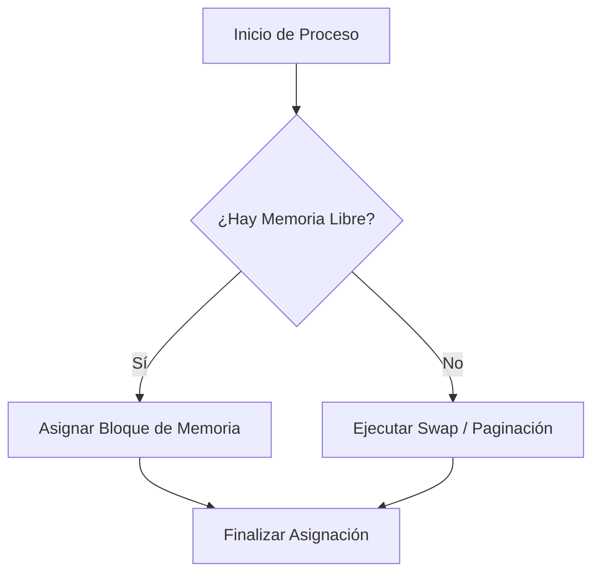
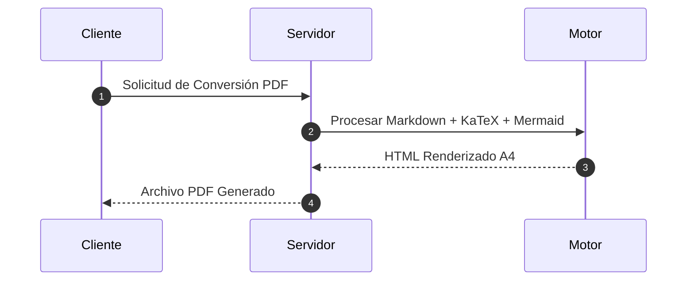
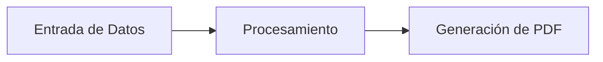

# Manual de Sintaxis y Capacidades del Conversor (PDF Converter)

Este documento contiene la guía completa de sintaxis Markdown extendida, marcadores especiales y capacidades visuales soportadas por el motor de **PDF Converter**. Está diseñado para ser utilizado como manual de referencia tanto por usuarios como por **Modelos de Inteligencia Artificial (IA)** para generar documentos con el formato adecuado.

---

## 📋 Índice
1. [Resaltado de Texto en Tonos Pastel](#1-resaltado-de-texto-en-tonos-pastel)
2. [Fórmulas Matemáticas y Ecuaciones (KaTeX)](#2-fórmulas-matemáticas-y-ecuaciones-katex)
3. [Diagramas Visuales y Flujos (Mermaid)](#3-diagramas-visuales-y-flujos-mermaid)
4. [Bloques de Código y Resaltado Sintáctico](#4-bloques-de-código-y-resaltado-sintáctico)
5. [Control de Paginación y Saltos de Página A4](#5-control-de-paginación-y-saltos-de-página-a4)
6. [Tabla de Contenidos Automática (TOC)](#6-tabla-de-contenidos-automática-toc)
7. [Tablas y Citas](#7-tablas-y-citas)
8. [Configuración de Portadas](#8-configuración-de-portadas)
9. [Temas Visuales Disponibles](#9-temas-visuales-disponibles)
10. [Plantilla Base Completa para IA](#10-plantilla-base-completa-para-ia)

---

## 1. 🎨 Resaltado de Texto en Tonos Pastel

El conversor incluye un sistema especial de resaltados en colores pastel mediante marcas superpuestas `==`.

### Sintaxis con color específico
```markdown
==Texto a resaltar==(nombre_color)
```

### Paleta de colores pastel soportados:
* **Amarillo (Por defecto)**: `==Texto en amarillo==(amarillo)` o simplemente `==Texto en amarillo==`
* **Rosa**: `==Concepto o definición clave==(rosa)`
* **Rojo**: `==Advertencia, error o estado crítico==(rojo)`
* **Verde**: `==Solución o estado exitoso==(verde)`
* **Celeste**: `==Referencia técnica o dato relevante==(celeste)`
* **Naranja**: `==Nota importante o aclaración==(naranja)`
* **Violeta**: `==Conclusión o resumen==(violeta)`
* **Color HEX personalizado**: `==Color a medida==(#d1e7dd)`

### Formatos combinados internos:
Podés aplicar estilos dentro del texto resaltado:
```markdown
==**Texto resaltado en negrita**==(rosa)
==*Texto resaltado en cursiva*==(verde)
```

---

## 2. 🧮 Fórmulas Matemáticas y Ecuaciones (KaTeX)

El motor procesa ecuaciones KaTeX con tipografía dedicada (`KaTeX_Main`).

### Matemáticas en línea (*inline*)
Delimitadas por un solo signo de dólar `$ ... $`:
```markdown
La famosa ecuación de Einstein es $E = mc^2$.
La complejidad temporal del algoritmo es $\mathcal{O}(n \log n)$.
```

### Ecuaciones centradas en bloque (*display*)
Delimitadas por doble signo de dólar `$$ ... $$`:
```markdown
$$\text{Rendimiento} = \frac{\text{Tiempo Efectivo}}{\text{Tiempo Total}} \times 100\%$$

$$\sum_{i=1}^{n} i = \frac{n(n+1)}{2}$$

$$\lim_{x \to 0} \frac{\sin(x)}{x} = 1$$
```

---

## 3. 📊 Diagramas Visuales y Flujos (Mermaid)

Podés incluir diagramas expresados en bloques de código `mermaid`. El conversor aplica post-procesado matemático para garantizar alineación centrada Flexbox y escalado dinámico en los PDFs.

### Diagrama de Flujo (*Flowchart*)


### Diagrama de Secuencia (*Sequence Diagram*)


---

## 4. 💻 Bloques de Código y Resaltado Sintáctico

### Bloques de código multilínea
Delimitados por triple comilla invertida con la especificación del lenguaje (resaltados mediante Pygments):

```python
def procesar_documento(ruta_archivo: str) -> bool:
    """Procesa y valida el documento Markdown."""
    if not ruta_archivo.endswith('.md'):
        raise ValueError("El archivo debe ser extensión .md")
    print(f"Convertiendo {ruta_archivo} a PDF...")
    return True
```

```javascript
async function exportToPdf(htmlContent) {
  const response = await fetch('/api/export/pdf', {
    method: 'POST',
    body: JSON.stringify({ html: htmlContent })
  });
  return await response.blob();
}
```

Lenguajes comunes soportados: `python`, `javascript`, `typescript`, `html`, `css`, `bash`, `cpp`, `c`, `json`, `sql`, `yaml`, `markdown`.

### Código en línea (*inline*)
Delimitado por backticks simples `` `código` ``:
```markdown
Para instalar las dependencias usá el comando `pip install -r requirements.txt`.
```

---

## 5. 📄 Control de Paginación y Saltos de Página A4

El documento fluye automáticamente en hojas A4 (`210mm x 297mm`) con márgenes homogéneos de 20mm y fondo continuo *full-bleed*.

### Salto de página manual explícito
Si querés forzar que una sección o apartado empiece en una página limpia, insertá el siguiente marcador HTML en una línea independiente:

```markdown
<!-- PAGEBREAK -->
```

*(Nota: El motor previene y elimina automáticamente saltos de página vacíos o redundantes).*

---

## 6. 📑 Tabla de Contenidos Automática (TOC)

Para generar un índice interactivo y automático de títulos (H1, H2, H3), agregá el marcador:

```markdown
<!-- TOC -->
```

El conversor calculará los hipervínculos internos y los números de página exactos según la paginación física.

---

## 7. 📊 Tablas y Citas

### Tablas con encabezado con tema
Las tablas adoptan los colores primarios y secundarios del tema activo:

| Componente | Función | Estado |
|---|---|---|
| **Editor Markdown** | Edición en tiempo real | ✅ Activo |
| **Vista Previa A4** | Paginado y renderizado dinámico | ✅ Activo |
| **Exportador PDF** | Generación de alta fidelidad | ✅ Activo |

### Bloques de Cita (*Blockquotes*)
```markdown
> **Nota importante:** Todos los estilos visuales de fuentes y colores son adaptables a través del menú de temas de la aplicación.
```

---

## 8. 🖼️ Configuración de Portadas

Podés configurar la portada desde el botón **📖 Configurar Portada** en la aplicación o incluyendo metadatos en el encabezado del documento Markdown:

```markdown
# Título del Documento Principal

**Materia:** Sistemas Operativos / Arquitectura de Software
**Integrantes:** Juan Pérez, María Gómez
**Profesor:** Ing. Carlos Rodríguez
**Fecha:** Agosto 2026
```

Estilos de carátula disponibles:
1. **Minimalista** (Limpia y moderna)
2. **Académica** (Estilo universitario tradicional)
3. **Tipográfica** (Enfocada en títulos de gran impacto)
4. **Orgánica** (Diseño suave con acentos pastel)

---

## 9. 🎨 Temas Visuales Disponibles

El conversor cuenta con 6 temas predefinidos:
1. `minimal`: **Minimalista Moderno** (Sans-serif limpia, alto contraste)
2. `classic`: **Académico Clásico** (Fuentes serif estilo papel hueso/crema)
3. `institutional`: **Institucional** (Azul corporativo profesional)
4. `editorial`: **Editorial Moderno** (Elegante en tonos borgoña/vino)
5. `blueprint`: **Técnico Claro** (Estilo técnico en tonos azul eléctrico)
6. `pastel`: **Cuadernillo Pastel** (Tonos suaves ideales para apuntes de estudio)

---

## 10. 📝 Plantilla Base Completa para IA

Copia y pega la siguiente plantilla para indicarle a una IA que genere un documento perfectamente formateado para **PDF Converter**:

```markdown
# Titulo de la Monografía o Trabajo

**Materia:** Nombre de la Materia
**Integrantes:** Nombre del Alumno
**Fecha:** 2026

<!-- TOC -->

<!-- PAGEBREAK -->

## 1. Resumen Ejecutivo

==Este resumen contiene los aspectos clave del informe==(celeste).

* Definición principal: ==Concepto fundamental==(rosa)
* Advertencia de uso: ==Tener en cuenta esta condición==(rojo)

---

## 2. Desarrollo Teórico

La ecuación general de evaluación viene dada por:

$$\text{Puntaje} = \sum_{i=1}^{n} w_i \cdot x_i$$

Donde $w_i$ representa el peso relativo.

<!-- PAGEBREAK -->

## 3. Flujo de Trabajo



### Código de Implementación
```python
def main():
    print("Documento generado correctamente")
```

<!-- PAGEBREAK -->

## 4. Conclusiones

> ==En conclusión, el modelo cumple con los requerimientos exigidos.==(violeta)
```
