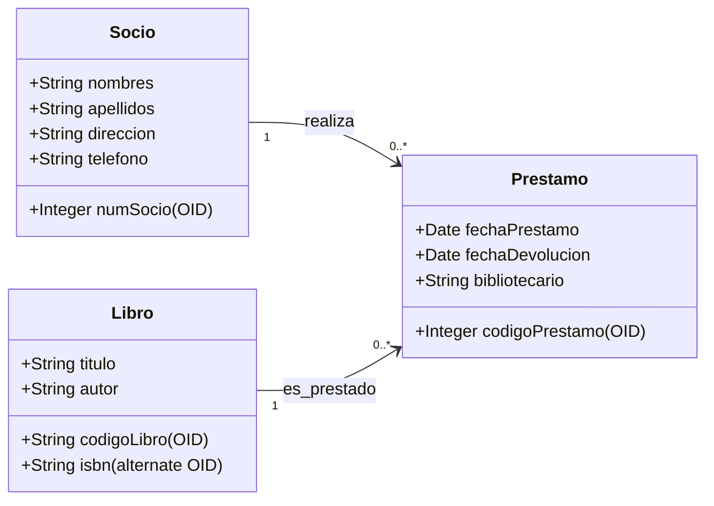
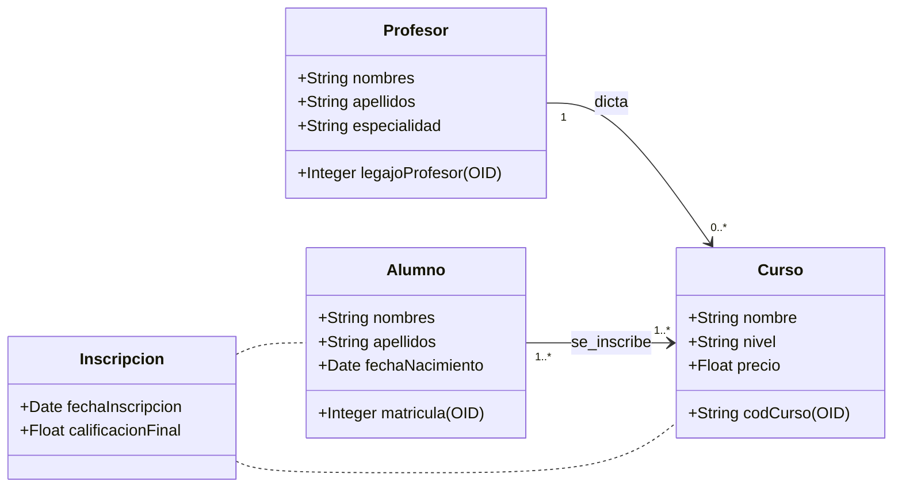
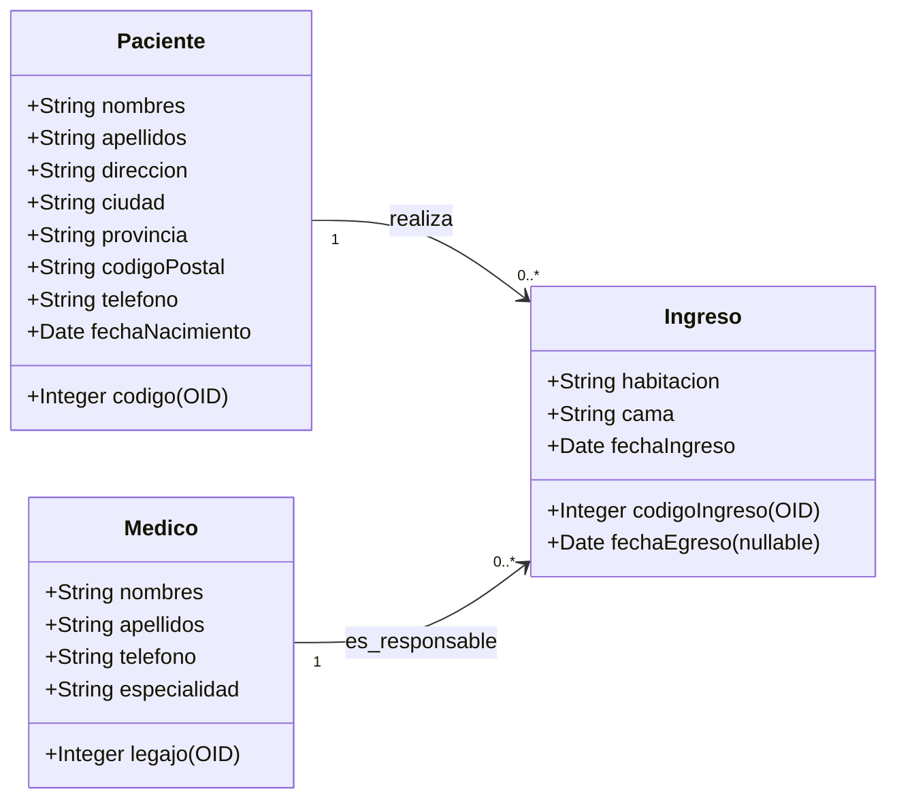
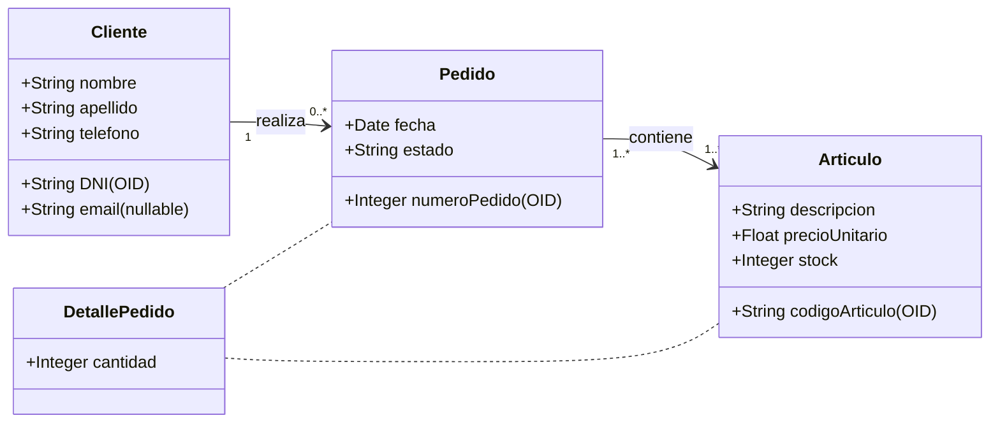
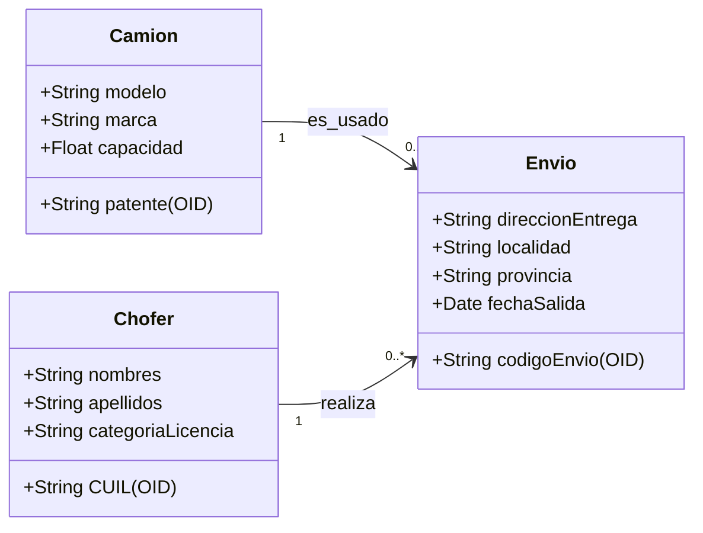

Aquí tienes **5 modelos de examen parcial** adaptados estrictamente a tu nueva indicación: la parte práctica consiste exclusivamente en diseñar un **Diagrama de Clases UML** (con su respectiva respuesta en formato de código **Mermaid** al final del documento), y la parte teórica evalúa los contenidos conceptuales clave de tu materia, prescindiendo por completo de normalización y dependencias funcionales.

---

# BANCO DE EXÁMENES PARCIALES (TEORÍA Y DIAGRAMAS DE CLASES)

## 📝 MODELO DE PARCIAL 1

### Ejercicio 1: Caso Práctico (Diagrama de Clases UML)

La biblioteca popular **"Sarmiento"** requiere un sistema de gestión de préstamos de libros.

- De cada **Socio** se desea registrar: número de socio (identificador único), nombres, apellidos, dirección y teléfono.
- De cada **Libro** se desea registrar: código de libro (identificador único), título, ISBN (identificador alternativo) y autor.
- Un socio puede realizar múltiples **Préstamos** de libros. De cada préstamo se almacena: un código de préstamo (identificador único), fecha de préstamo, fecha de devolución pactada y el nombre del bibliotecario responsable.
- Cada préstamo involucra obligatoriamente un único libro y un único socio. Un libro puede ser prestado muchas veces a lo largo del tiempo, y un socio puede realizar múltiples préstamos.

**Consigna:** Diseñe el **Diagrama de Clases UML** correspondiente a este dominio, especificando nombres de clases, atributos, visibilidades, identificadores de objeto `(OID)`, identificadores alternativos `(alternate OID)`, multiplicidades y el sentido de las relaciones.

### Ejercicio 2: Preguntas Teóricas

1. Explique la diferencia fundamental entre el concepto de **"Dato"** e **"Información"** conforme a la bibliografía de la materia, proporcionando un ejemplo de cada uno.
2. ¿Qué es la **independencia física de datos**, con qué nivel de la arquitectura de tres niveles se relaciona y mediante qué mecanismo se logra?

---

## 📝 MODELO DE PARCIAL 2

### Ejercicio 1: Caso Práctico (Diagrama de Clases UML)

Una **Academia de Idiomas** necesita gestionar sus cursos y alumnos.

- De cada **Curso** se registra: código de curso (único), nombre, nivel y precio.
- De cada **Profesor** se guarda: legajo de profesor (único), nombres, apellidos y especialidad. Cada curso tiene asignado obligatoriamente un único profesor responsable, pero un profesor puede dictar varios cursos (o ninguno).
- De cada **Alumno** se almacena: número de matrícula (único), nombres, apellidos y fecha de nacimiento.
- Un alumno puede inscribirse en varios cursos, y en un curso puede haber muchos alumnos inscritos. De cada **Inscripción** se debe registrar obligatoriamente la fecha de inscripción y la calificación final obtenida. Al ser una relación muchos a muchos con atributos propios, documéntela adecuadamente.

**Consigna:** Elabore el **Diagrama de Clases UML** indicando atributos de relación mediante una clase de asociación, especificando multiplicidades e identificadores `(OID)`.

### Ejercicio 2: Preguntas Teóricas

1. Detalle de forma exhaustiva al menos cuatro **responsabilidades o funciones clave del Administrador de Base de Datos (DBA)** dentro de una organización.
2. Explique detalladamente la **Regla de Integridad Referencial** y qué restricciones impone sobre los valores de la base de datos.

---

## 📝 MODELO DE PARCIAL 3

### Ejercicio 1: Caso Práctico (Diagrama de Clases UML)

La clínica **"SANTA PAZ"** necesita llevar un control informatizado de su gestión de pacientes y médicos.

- De cada **Paciente** se desea guardar: un código de paciente (único), nombres, apellidos, dirección, ciudad, provincia, código postal, teléfono y fecha de nacimiento.
- De cada **Médico** se desea guardar: legajo (único), nombres, apellidos, teléfono y especialidad.
- Se desea controlar cada uno de los **Ingresos** que el paciente realiza en el hospital. De cada ingreso se guarda un código de ingreso (único), el número de habitación, la cama, la fecha de ingreso y la fecha de egreso (que es opcional, ya que puede no haber recibido el alta aún).
- Cada ingreso pertenece a un único paciente y tiene asignado un único médico asociado como responsable. Un paciente puede realizar múltiples ingresos a lo largo del tiempo, y un médico puede ser responsable de muchos ingresos.

**Consigna:** Diseñe el **Diagrama de Clases UML** que represente fielmente estas reglas de negocio, utilizando la notación de atributos obligatorios y opcionales `(nullable)` donde corresponda.

### Ejercicio 2: Preguntas Teóricas

1. Describa detalladamente los tres niveles de la **Arquitectura ANSI/SPARC** y explique detalladamente las características que definen al **Nivel Conceptual**.
2. Indique cuáles son las tres **propiedades formales** obligatorias que debe cumplir una tabla para que pueda ser considerada una relación relacional.

---

## 📝 MODELO DE PARCIAL 4

### Ejercicio 1: Caso Práctico (Diagrama de Clases UML)

Un **Sistema de Ventas** requiere controlar los pedidos de sus clientes.

- De cada **Cliente** se registra: DNI (único), nombre, apellido, teléfono y un email (que es opcional).
- De cada **Artículo** se guarda: código de artículo (único), descripción, precio unitario y stock.
- De cada **Pedido** se registra: número de pedido (único), fecha y estado. Un pedido pertenece a un único cliente, pero un cliente puede realizar muchos pedidos.
- Un pedido puede contener múltiples artículos, y un artículo puede figurar en muchos pedidos. Se debe almacenar la **cantidad** solicitada de cada artículo en cada pedido. Como un cliente puede volver a pedir el mismo artículo en diferentes pedidos, diseñe esta relación de forma que la cantidad quede asociada de manera correcta.

**Consigna:** Elabore el **Diagrama de Clases UML** aplicando clases de asociación o clases completas para resolver la relación muchos a muchos con atributos.

### Ejercicio 2: Preguntas Teóricas

1. Realice una comparación detallada entre el **Enfoque Tradicional de Ficheros** y el **Enfoque de Bases de Datos (DBMS)** en relación con el control de la redundancia, la consistencia, y el acceso a los datos.
2. Defina formalmente los siguientes conceptos del modelo relacional: **Superclave, Clave Candidata y Clave Primaria**.

---

## 📝 MODELO DE PARCIAL 5

### Ejercicio 1: Caso Práctico (Diagrama de Clases UML)

Una **Empresa de Logística** desea registrar la asignación de sus camiones a distintos envíos.

- De cada **Camión** se registra: patente (única), modelo, marca y capacidad de carga.
- De cada **Chofer** se guarda: CUIL (único), nombres, apellidos y categoría de licencia.
- Un **Envío** se registra con un código de envío (único), dirección de entrega, localidad, provincia y fecha de salida.
- Cada envío es asignado obligatoriamente a un único camión y a un único chofer. Un chofer puede realizar muchos envíos a lo largo del tiempo, y un camión puede ser utilizado en múltiples envíos.

**Consigna:** Diseñe el **Diagrama de Clases UML** que represente este modelo de datos, indicando las clases, atributos y multiplicidades de cada extremo.

### Ejercicio 2: Preguntas Teóricas

1. Explique detalladamente en qué consisten la **Regla 1 (De la Información)** y la **Regla 2 (Acceso Garantizado)** de las 12 Reglas de Codd.
2. Describa qué es un sublenguaje **DDL** y un sublenguaje **DML**, indicando qué operaciones fundamentales permite realizar cada uno dentro de un DBMS.

---

---

# 🔑 RESOLUCIONES DE LOS MODELOS (DIAGRAMAS DE CLASES UML)

A continuación, se presentan las resoluciones teóricas oficiales y los diagramas de clases representados en código **Mermaid**.

---

## 🟢 RESOLUCIÓN - MODELO DE PARCIAL 1

### Ejercicio 1: Diagrama de Clases UML (Mermaid)

### Ejercicio 2: Respuestas Teóricas

1. **Dato e Información**: El **Dato** es el valor en crudo o la representación simbólica de una propiedad o hecho aislado, desprovisto de procesamiento o contexto semántico inmediato (por ejemplo: el apellido _"Sánchez"_ o el número _41_). Por el contrario, la **Información** es un dato o conjunto de datos procesados, estructurados y contextualizados que adquieren un significado relevante y útil para un usuario en la toma de decisiones (por ejemplo: _"El cliente con apellido Sánchez tiene 41 años"_).
2. **Independencia Física de Datos**: Es la capacidad de alterar el esquema interno o físico de almacenamiento (por ejemplo, migrar de discos HDD mecánicos a unidades de estado sólido SSD, reorganizar particiones o agregar un índice B+) sin que sea necesario modificar el esquema conceptual ni los programas de aplicación de usuario. Se logra mediante la flexibilidad y parametrización del **mapeo entre el nivel conceptual y el nivel interno** de la arquitectura ANSI/SPARC.

---

## 🔵 RESOLUCIÓN - MODELO DE PARCIAL 2

### Ejercicio 1: Diagrama de Clases UML (Mermaid)

### Ejercicio 2: Respuestas Teóricas

1. **Responsabilidades del DBA (Database Administrator)**:
   - **Definir los esquemas conceptual e interno**, ejecutando el diseño lógico y físico global de toda la base de datos.
   - **Establecer y administrar las restricciones de seguridad**, definiendo las políticas de acceso, autenticación, roles e integridad de los datos.
   - **Coordinar los requerimientos de la comunidad de usuarios** y encargarse de definir las vistas externas personalizadas para cada grupo o aplicación.
   - **Implementar y monitorear estrategias de respaldo (backup) y recuperación ante fallos (recovery)** para garantizar la seguridad de la información.
   - **Optimizar el rendimiento del motor (DBMS)** mediante técnicas como ajuste de índices, particionado físico y balanceo de carga.

2. **Regla de Integridad Referencial**: Determina que los valores de una **Clave Foránea (FK)** en una relación secundaria deben coincidir de forma exacta con un valor existente en la **Clave Primaria (PK)** de la relación que referencia, o bien ser nulos (`NULL`) en caso de que la relación entre ambas entidades sea opcional. Bajo ningún concepto se permiten valores huérfanos o sin concordancia en la tabla destino.

---

## 🟡 RESOLUCIÓN - MODELO DE PARCIAL 3

### Ejercicio 1: Diagrama de Clases UML (Mermaid)

### Ejercicio 2: Respuestas Teóricas

1. **Niveles de la Arquitectura ANSI/SPARC**:
   - **Nivel Interno (Físico)**: El nivel más bajo de abstracción; describe cómo se almacenan físicamente los datos en la memoria secundaria (organización de registros, índices, compresión).
   - **Nivel Externo (Vistas)**: El nivel más alto; compuesto por las múltiples vistas personalizadas para cada usuario o aplicación, ocultando partes irrelevantes de la BD por seguridad.
   - **Nivel Conceptual (Esquema Lógico Global)**: Es el nivel intermedio. Describe qué datos se almacenan para toda la comunidad de usuarios. Modela la estructura total de la base de datos (entidades, atributos, relaciones, restricciones de integridad y reglas del negocio) **prescindiendo por completo de detalles técnicos de hardware** o almacenamiento físico.

2. **Propiedades Formales de una Relación**:
   - **Unicidad de Tuplas**: No pueden existir dos filas idénticas o duplicadas dentro de una relación; cada registro debe poseer al menos una clave que lo distinga.
   - **Desorden de Filas y Columnas**: El orden en el que se almacenan o visualizan las filas y las columnas carece de relevancia lógica para el sistema.
   - **Atomicidad de Atributos**: Cada celda de la tabla debe contener exclusivamente un único valor indivisible del dominio; se prohíbe el uso de datos compuestos, listas o tablas anidadas.

---

## 🔴 RESOLUCIÓN - MODELO DE PARCIAL 4

### Ejercicio 1: Diagrama de Clases UML (Mermaid)

### Ejercicio 2: Respuestas Teóricas

1. **Comparativa: Enfoque de Ficheros vs. Enfoque de Bases de Datos (DBMS)**:
   - **Redundancia**: En ficheros es _alta y descontrolada_ (los mismos datos se duplican en múltiples archivos de distintos programas). En un DBMS es _mínima y controlada_ porque los datos están integrados en un repositorio único.
   - **Consistencia**: En ficheros es _inconsistente_ debido a que actualizar un dato en un archivo suele dejarlo desactualizado en otros. En un DBMS la integridad está _garantizada_, pues las modificaciones se propagan de forma única e inmediata.
   - **Acceso a Datos**: En ficheros es _rígido y complejo_, requiriendo programar un código fuente específico para cada nueva consulta. En un DBMS es _flexible y declarativo_ mediante lenguajes estándar de alto nivel (como SQL).

2. **Definiciones Formales de Claves**:
   - **Superclave**: Cualquier conjunto de uno o más atributos que permite identificar de manera unívoca una tupla dentro de una relación. Puede contener atributos redundantes no indispensables.
   - **Clave Candidata**: Es toda superclave que cumple con la propiedad de **irreducibilidad** o minimalidad (no tiene atributos sobrantes; si se quita uno solo, pierde la capacidad de identificación unívoca).
   - **Clave Primaria (PK)**: Es la clave candidata formalmente elegida por el diseñador de la base de datos para identificar unívocamente las tuplas en todo el sistema.

---

## 🔵 RESOLUCIÓN - MODELO DE PARCIAL 5

### Ejercicio 1: Diagrama de Clases UML (Mermaid)

### Ejercicio 2: Respuestas Teóricas

1. **Reglas de Codd**:
   - **Regla 1 (De la Información)**: Toda la información contenida en una base de datos relacional debe ser representada explícitamente en el nivel lógico de una única forma: como valores almacenados en las celdas de las tablas.
   - **Regla 2 (Acceso Garantizado)**: Cada dato atómico individual debe ser lógicamente accesible en todo momento mediante una combinación unívoca tridimensional: el **Nombre de la Tabla**, el **Valor de la Clave Primaria** de la fila, y el **Nombre de la Columna** (atributo).

2. **Sublenguajes DDL y DML**:
   - **DDL (Data Definition Language)**: Es el lenguaje de definición de datos. Permite declarar, crear, alterar y eliminar esquemas y objetos de la base de datos (tablas, índices, restricciones de integridad y vistas).
   - **DML (Data Manipulation Language)**: Es el lenguaje de manipulación de datos. Permite a los usuarios y programas consultar la información almacenada, así como insertar nuevas tuplas, actualizar registros existentes y borrar filas de la base de datos.

---

💬 **¿Qué te parece si seleccionamos uno de estos diagramas de clases y lo transformamos paso a paso al modelo relacional aplicando formalmente el algoritmo de mapeo de 7 pasos que vimos en tus apuntes?**
