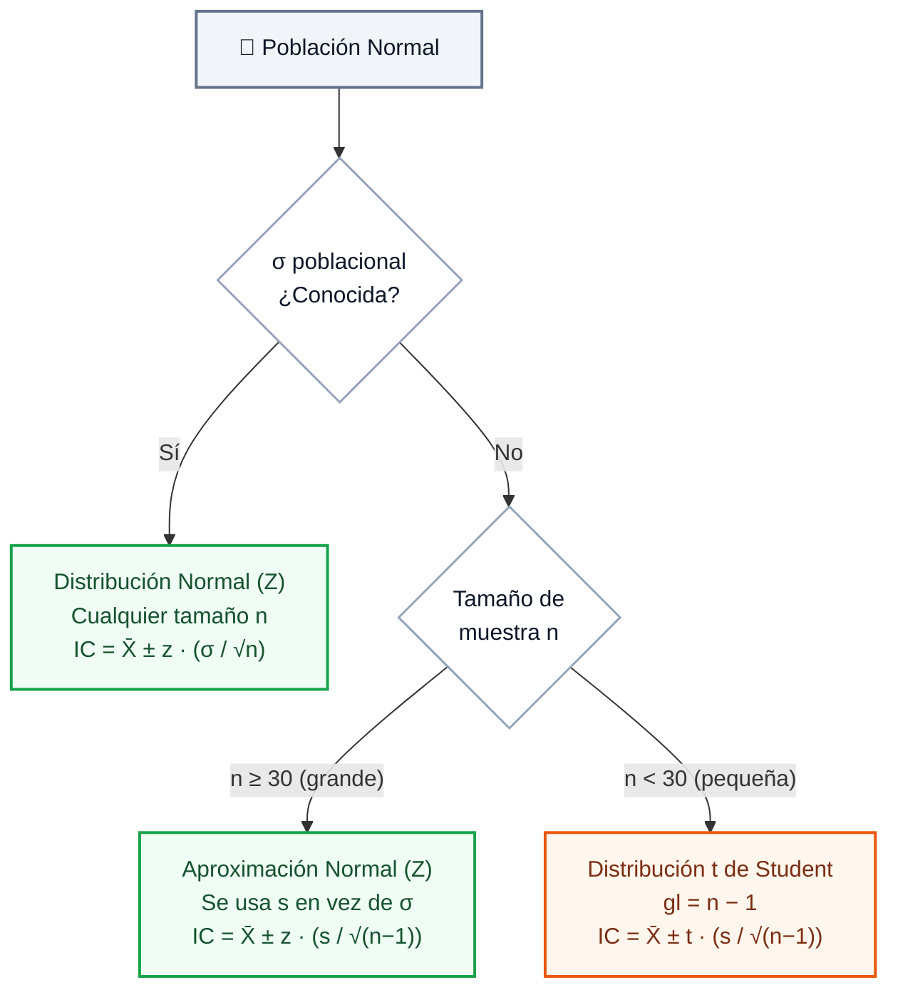
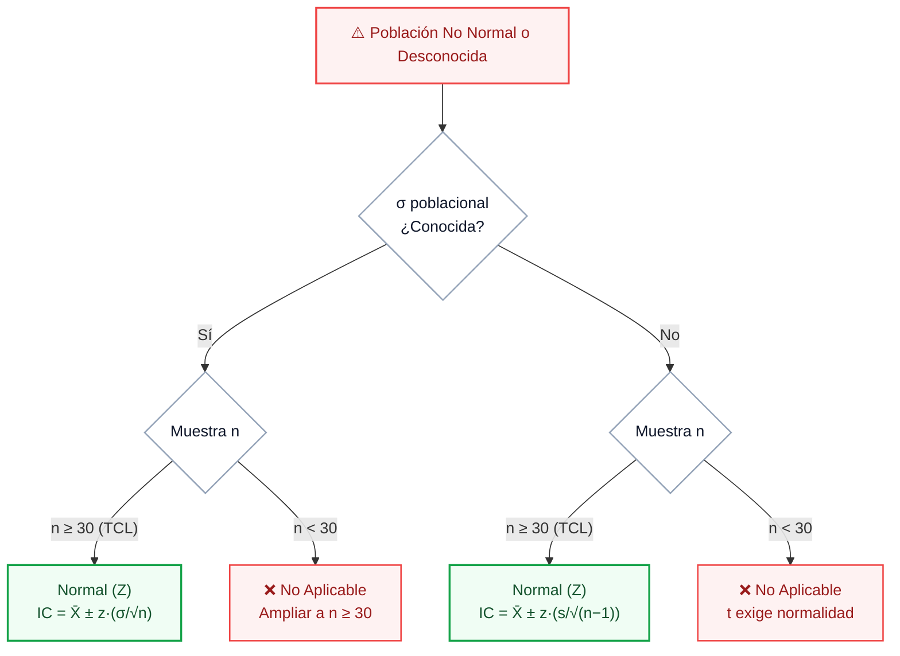
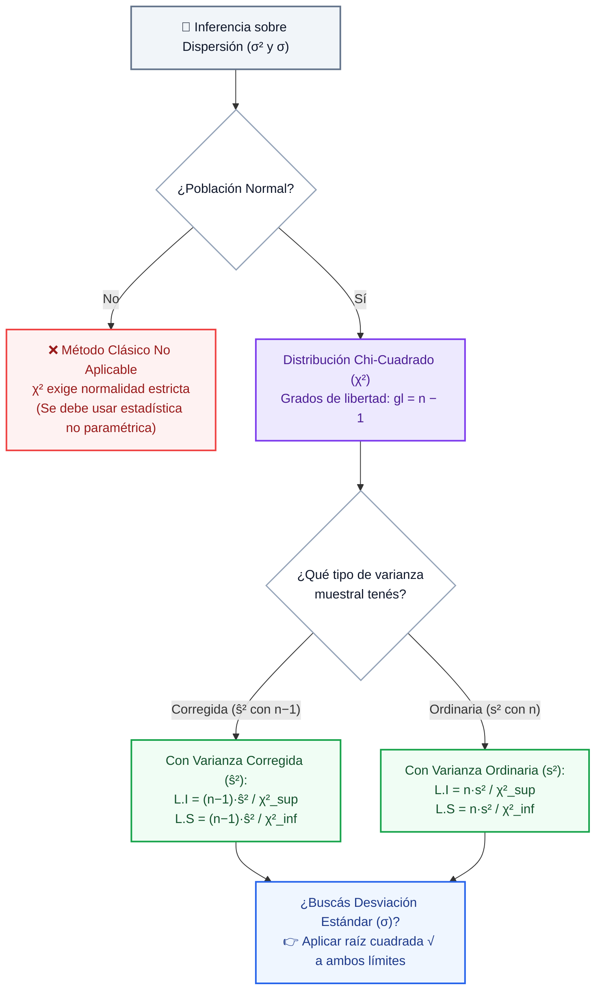

---
coverConfig:
  showCover: false
  title: Resumen de Estadistica
  subtitle: ''
  materia: ''
  coverStyle: blanca_simple
  showLogo: true
  integrantes: []
  profesores: []
  sigla: ''
  fecha: ''
  showHeader: true
  headerLeft: '{sigla} - {titulo}'
  headerCenter: ''
  headerRight: '{fecha}'
  headerShowLine: true
  showFooter: true
  footerLeft: '{materia}'
  footerCenter: ''
  footerRight: ''
  footerNumbering: pagina_x_de_y
  footerShowLine: true
activeTheme: minimal
---
# **Resumen de Probabilidad y Estadística**

---

## **1. Modelos Probabilísticos Continuos**

### **1.1 Concepto de Variable Aleatoria Continua**

- **Definición formal:** Una variable aleatoria $X$ es ==variable aleatoria continua==(celeste) cuando proviene de un proceso de **medición** y puede asumir **infinitos valores** dentro de un intervalo real $\mathbb{R}$.
- **Probabilidad puntual nula:**  
  $$P(X = x) = 0$$  
  Para toda variable continua, la probabilidad en un punto individual es estrictamente **cero**.
- **Probabilidad sobre intervalos:** La probabilidad se calcula exclusivamente integrando el **área bajo la curva** de su función de densidad de probabilidad $f(x)$:  
  $$P(a \le X \le b) = \int_{a}^{b} f(x) \, dx$$
- **Condiciones obligatorias de la función de densidad:**
  - **No negatividad:** $f(x) \ge 0 \quad \forall x \in \mathbb{R}$
  - **Área total unitaria:** $\int_{-\infty}^{\infty} f(x) \, dx = 1$ (representa el 100% de probabilidad del espacio muestral).

> 💡 **En criollo:** Pensá en la altura de las personas. ¿Cuál es la probabilidad de que alguien mida *exactamente* 1.7500000... metros? Cero, porque entre 1.75 y 1.76 hay infinitos valores posibles. Lo que sí tiene sentido es preguntar: *"¿cuánta gente mide entre 1.70 y 1.80?"*. Eso es el área bajo la curva.

---

### **1.2 Distribución Normal (Gaussiana)**

#### **A. Definición y Notación**
Una variable aleatoria continua $X$ sigue una distribución normal con parámetros de **media** $\mu$ ($-\infty < \mu < \infty$) y **varianza** $\sigma^2$ ($\sigma > 0$), denotada formalmente como:

$$X \sim N(\mu, \sigma^2)$$

#### **B. Función de Densidad**
$$
f(x) = \frac{1}{\sigma \sqrt{2\pi}} \cdot e^{-\frac{1}{2}\left(\frac{x-\mu}{\sigma}\right)^2} \quad (-\infty < x < \infty)
$$

*(con constantes $\pi \approx 3.14159$ y $e \approx 2.71828$)*.

#### **C. Características y Propiedades Fundamentales**
- **Forma acampanada y simétrica:** La curva es perfectamente simétrica respecto a la media poblacional $\mu$.
- **Coincidencia de medidas centrales:** En el eje central coinciden exactamente la media, la mediana y la moda:  
  $$\mathbf{\mu = Me = Mo}$$
- **Área total bajo la curva:** El área total es igual a **1** (repartida en exactamente **0.5** a la izquierda de $\mu$ y **0.5** a la derecha).
- **Comportamiento asintótico:** La curva desciende suavemente hacia ambos extremos; cuando $x \to \pm\infty$, la función tiende a cero pero **nunca toca el eje horizontal**.
- **Punto máximo absoluto:** Se ubica exactamente en la media:  
  $$\left(\mu; \; \frac{1}{\sigma \sqrt{2\pi}}\right)$$
- **Puntos de inflexión:** Puntos exactos donde la curvatura cambia de cóncava hacia abajo a cóncava hacia arriba:  
  $$\mathbf{x = \mu - \sigma} \qquad \text{y} \qquad \mathbf{x = \mu + \sigma}$$
- **Regla Empírica de Dispersión:**
  - **$P(\mu - \sigma \le X \le \mu + \sigma) \approx 0.6827$** (el **68.27%** de los datos cae a $\pm 1$ desvío).
  - **$P(\mu - 2\sigma \le X \le \mu + 2\sigma) \approx 0.9545$** (el **95.45%** de los datos cae a $\pm 2$ desvíos).
  - **$P(\mu - 3\sigma \le X \le \mu + 3\sigma) \approx 0.9973$** (el **99.73%** de los datos cae a $\pm 3$ desvíos).

```stats-plot
type: normal
mu: 0
sigma: 1
shade: [-1, 1]
shadeLabel: "P(-1 ≤ Z ≤ 1) ≈ 68.27%"
title: "Distribución Normal Estándar N(0, 1)"
subtitle: "Media μ = 0, Desvío σ = 1. Puntos de inflexión en μ ± σ"
xLabel: "Variable tipificada (Z)"
```

#### **D. Rol e Influencia de los Parámetros**
- **Media ($\mu$):** Parámetro de ==posición / localización==(amarillo). Desplaza la campana horizontalmente a lo largo del eje $x$ sin alterar su ancho ni su altura.
- **Desvío estándar ($\sigma$):** Parámetro de ==forma / dispersión==(naranja).
  - **A mayor $\sigma$:** Mayor variabilidad, la campana se aplana y se ensancha.
  - **A menor $\sigma$:** Menor variabilidad, la campana es más estilizada, puntiaguda y concentrada en torno a $\mu$.
  - Por lo tanto, para infinitas combinaciones de $\mu$ y $\sigma$ existen **infinitas curvas normales**.

#### **E. Estandarización y Variable Tipificada $Z$**
Transforma cualquier variable $X \sim N(\mu, \sigma^2)$ en una ==distribución normal estándar==(celeste) $Z \sim N(0, 1)$ con media $0$ y desvío $1$:

$$Z = \frac{X - \mu}{\sigma}
$$

> 💡 **En criollo:** Estandarizar es como traducir notas de distintas materias a una escala común. Si en Matemática sacás 7 (promedio 5, desvío 2) y en Historia sacás 8 (promedio 7, desvío 1), ¿en cuál te fue mejor *relativo al curso*? Con la fórmula Z: Mate → $Z = (7-5)/2 = 1$ y Historia → $Z = (8-7)/1 = 1$. ¡Igual de bien en ambas!

- **Demostración de la Media $E(Z) = 0$:**
  $$E(Z) = E\left(\frac{X - \mu}{\sigma}\right) = \frac{E(X) - \mu}{\sigma} = \frac{\mu - \mu}{\sigma} = 0$$

- **Demostración de la Varianza $\text{Var}(Z) = 1$:**
  $$\text{Var}(Z) = \text{Var}\left(\frac{X - \mu}{\sigma}\right) = \frac{1}{\sigma^2} \text{Var}(X - \mu) = \frac{1}{\sigma^2} \text{Var}(X) = \frac{\sigma^2}{\sigma^2} = 1$$

- **Cálculo de probabilidad mediante la tabla normal:**
  $$P(x_1 \le X \le x_2) = P\left(\frac{x_1 - \mu}{\sigma} \le Z \le \frac{x_2 - \mu}{\sigma}\right) = \Phi(z_2) - \Phi(z_1)$$

\newpage

### **1.3 Distribución t de Student**

#### **A. Definición y Función de Densidad**
Se utiliza para realizar inferencia sobre la **media poblacional $\mu$** cuando la **varianza poblacional $\sigma^2$ es desconocida** y se dispone de una **muestra pequeña ($n < 30$)**, estimando $\sigma$ a través del desvío muestral $s$. Su función de densidad es:

$$
h(t) = \frac{\Gamma\left(\frac{n+1}{2}\right)}{\Gamma\left(\frac{n}{2}\right)\sqrt{\pi n}} \cdot \left(1 + \frac{t^2}{n}\right)^{-\frac{n+1}{2}} \quad (-\infty < t < \infty)
$$

*(donde $\Gamma(n) = \int_0^\infty e^{-x} x^{n-1} dx$ es la función Gamma)*.

#### **B. Propiedades Clave**
- **Simetría:** Es acampanada y simétrica respecto a $\mathbf{t = 0}$, con media $E(t) = 0$.
- **Colas pesadas:** Presenta ==colas pesadas==(naranja) (más gruesas y levantadas) y una cúspide central más baja que la Normal estándar $Z$, absorbiendo la mayor incertidumbre propia de muestras pequeñas.
- **Parámetro determinante:** Depende exclusivamente de sus ==grados de libertad==(amarillo):  
  $$\mathbf{k = \nu = n - 1}$$
- **Fundamento de los grados de libertad ($n - 1$):** Al estimar previamente la media muestral $\bar{X}$, solo $n - 1$ observaciones son libres de variar de manera independiente; la última observación queda rígidamente fijada por la suma muestral total.
- **Convergencia asintótica:** A medida que aumentan los grados de libertad, la curva $t$ converge hacia la Normal estándar $Z$. A partir de **$n \ge 30$**, ambas distribuciones son prácticamente idénticas.
- **Requisito fundamental:** La población original de donde se extraen los datos debe seguir una **distribución normal**.

> [!WARNING] Trampa de examen
> Si te dan $n < 30$ y la población **NO es normal**, **NO podés usar t de Student**. Muchos pifian acá. La t de Student exige normalidad sí o sí.

> [!TIP] Regla rápida
> ¿$n \ge 30$? → Usá Z tranquilo (el TCL te cubre). ¿$n < 30$ con población normal y $\sigma$ desconocido? → Usá t de Student.

```stats-plot
type: compare_normal_student
df: 3
df2: 10
title: "Comparación: Distribución Normal Z vs. t de Student"
subtitle: "A menores grados de libertad (gl = 3), colas más pesadas y centro más bajo"
xLabel: "Valores estandarizados (t, Z)"
```

---

### **1.4 Distribución Chi-Cuadrado ($\chi^2$)**

#### **A. Definición y Origen**
Surge de la suma de los cuadrados de $k$ variables normales estándar independientes:

$$
\chi^2 = Z_1^2 + Z_2^2 + \dots + Z_k^2
$$

> 💡 **En criollo:** Imaginá que medís cuánto se desvía cada dato de la media y lo elevás al cuadrado (para que no se cancelen positivos con negativos). Sumás todo eso → eso es Chi-Cuadrado. Siempre da positivo (es una suma de cuadrados), por eso su gráfico arranca en cero y se extiende a la derecha.

Su único parámetro rector son sus ==grados de libertad==(amarillo) ($gl = k$).

#### **B. Función de Densidad**
$$
f(x) = \frac{1}{2^{k/2} \Gamma(k/2)} \cdot x^{\frac{k}{2} - 1} \cdot e^{-\frac{x}{2}} \quad (x > 0)
$$

#### **C. Propiedades Clave**
- **Valores no negativos:** Su soporte es estrictamente $\mathbf{\chi^2 \ge 0}$. No puede asumir valores negativos por tratarse de una suma de términos elevados al cuadrado.
- **Asimetría positiva:** Para grados de libertad pequeños, la distribución está fuertemente sesgada a la derecha y concentrada cerca de cero.
- **Convergencia a la normal:** Al incrementarse los grados de libertad ($k$), la curva se desplaza a la derecha, se aplana y se vuelve progresivamente simétrica, aproximándose a una campana normal.
- **Media y Varianza:**
  $$\mathbf{E(\chi^2) = k} \qquad \mathbf{\text{Var}(\chi^2) = 2k}$$
- **Área total:** El área total bajo la curva de densidad es igual a **1**.
- **Aplicación principal:** Se emplea para realizar estimaciones y contrastes sobre la ==varianza poblacional ($\sigma^2$)==(naranja) o desviación estándar a partir de una muestra.

```stats-plot
type: chi2
dfs: [2, 4, 8]
title: "Distribución Chi-Cuadrado (χ²) según Grados de Libertad (k)"
subtitle: "Soporte no negativo (x ≥ 0) y convergencia simétrica al aumentar k"
xLabel: "Valores de χ²"
```

---

### **1.5 Cuadro Comparativo de Modelos Continuos**

| Modelo Continuo | Soporte | Parámetros | Condiciones de Aplicación | Parámetro que Infiere |
| :--- | :--- | :--- | :--- | :--- |
| **Normal ($Z$)** | $(-\infty, \infty)$ | $\mu$ (media), $\sigma$ (desvío) | Desvío $\sigma$ poblacional conocido **O** muestra grande ($n \ge 30$) | Media poblacional ($\mu$) |
| **t de Student ($t$)** | $(-\infty, \infty)$ | $k = n - 1$ ($gl$) | Muestra pequeña ($n < 30$), $\sigma$ desconocido (usa $s$), población normal | Media poblacional ($\mu$) |
| **Chi-Cuadrado ($\chi^2$)** | $[0, \infty)$ | $k$ ($gl$) | Suma de normales al cuadrado, población normal | Varianza poblacional ($\sigma^2$) |

\newpage

---

## **2. Teoría del Muestreo**

### **2.1 Fundamento del Muestreo**

- **Concepto:** Hacer un muestreo consiste en ejecutar el procedimiento adecuado para seleccionar un subconjunto que represente fielmente las características de la población.
- **Los 6 Motivos Fundamentales para Trabajar con Muestras:**
  - **1. Económicamente imposible:** Inspeccionar o medir a la totalidad insumiría costos financieros y de instrumental desmedidos.
  - **2. Factor tiempo / Rapidez:** El censo insume semanas o meses; una muestra aporta información rápida para tomar decisiones oportunas.
  - **3. Calidad y fatiga:** Medir excesivos elementos genera errores humanos o de calibración por saturación, apuro o cansancio operativo.
  - **4. Uniforme (Homogeneidad del proceso):** En procesos automatizados o constantes, una muestra reducida es suficiente para representar al conjunto.
  - **5. Proceso destructivo:** Cuando la medición inutiliza o destruye la unidad analizada (ensayos de rotura o tracción), un censo destruiría toda la producción.
  - **6. Población infinita o inaccesible:** Poblaciones que conceptualmente no tienen fin o físicamente no pueden abarcarse en su totalidad.
- **Criterio de tamaño de muestra de la cátedra:** Se considera una muestra representativa y válida si abarca ==como mínimo el 30% de la población==(verde).

> 💡 **En criollo:** Es como probar la sopa: no necesitás tomarte toda la olla para saber si le falta sal. Con una cucharada bien revuelta alcanza. El muestreo es exactamente eso: agarrar un pedacito representativo para sacar conclusiones sobre el todo.

---

### **2.2 Lenguaje y Terminología del Muestreo**

- **Población ($N$):** Conjunto total de elementos bajo estudio que comparten una característica observable común.
- **Muestra ($n$):** Subconjunto de elementos seleccionados a partir de la población.
- **Parámetro:** Medida numérica fija y constante que describe una característica de toda la **población**. Suele ser desconocido:
  - **Media poblacional:** $\mu$
  - **Varianza poblacional:** $\sigma^2$
  - **Desvío estándar poblacional:** $\sigma$
  - **Proporción poblacional:** $p$
- **Estadístico:** Medida numérica calculada a partir de los datos observados en la **muestra**. Es una ==variable aleatoria==(rosa) porque su valor cambia con cada muestra extraída:
  - **Media muestral:** $\bar{X}$
  - **Varianza muestral:** $s^2$
  - **Desvío estándar muestral:** $s$
  - **Proporción muestral:** $\hat{p}$
- **Estimador:** Función, regla matemática o fórmula utilizada para inferir el valor de un parámetro poblacional a partir de un estadístico muestral.

> [!WARNING] Trampa de examen: Parámetro vs. Estadístico
> **Parámetro** = dato de la **población** (se escribe con letras griegas: $\mu$, $\sigma$, $p$). Es fijo pero desconocido.
> **Estadístico** = dato de la **muestra** (se escribe con letras latinas: $\bar{X}$, $s$, $\hat{p}$). Varía de muestra en muestra.
> Si te confundís estos dos, la deducción del intervalo de confianza no cierra.

---

### **2.3 Muestreos Probabilísticos**

Cada elemento de la población tiene una **probabilidad conocida y no nula** de ser seleccionado. Son los únicos métodos que garantizan representatividad estadística rigurosa y permiten acotar el error de muestreo.

#### **1. Muestreo Aleatorio Simple (MAS)**
Todos los individuos de la población tienen exactamente la misma probabilidad de ser elegidos al inicio del proceso.
- **Procedimiento:** 1) Definir población $N$ $\to$ 2) Asignar código único $\to$ 3) Definir tamaño $n$ $\to$ 4) Selección por sorteo, tablas aleatorias o software.
- **Modalidades de selección:**
  - **Con reemplazo (con reposición):** Cada elemento extraído se devuelve al lote antes del siguiente sorteo.  
    $$\mathbf{M = N^n} \quad \text{(Número de muestras posibles)}$$
  - **Sin reemplazo (sin reposición):** El elemento extraído no regresa; evita duplicados en la muestra (método más eficiente).  
    $$\mathbf{M = \binom{N}{n} = \frac{N!}{n!(N-n)!}} \quad \text{(Combinaciones posibles)}$$

#### **2. Muestreo Sistemático**
Se selecciona de forma aleatoria el primer elemento y los siguientes a intervalos regulares fijos.
- **Procedimiento:**
  - **Paso 1:** Calcular el intervalo o salto de muestreo:  
    $$\mathbf{i = \frac{N}{n}}$$
  - **Paso 2:** Elegir un número inicial de arranque al azar $r$ tal que $1 \le r \le i$.
  - **Paso 3:** Los elementos elegidos son:  
    $$\mathbf{r, \; r+i, \; r+2i, \; r+3i, \; \dots}$$
- **Requisito mandatorio:** La lista debe estar ordenada de forma uniforme y coherente, asegurando que no existan periodicidades ocultas que coincidan con el salto $i$.

#### **3. Muestreo Estratificado**
La población se divide en subgrupos llamados ==estratos==: grupos **internamente homogéneos** (muy parecidos entre sí dentro del estrato) y **externamente heterogéneos** (muy diferentes entre estratos distintos). Se toma una muestra independiente dentro de **todos y cada uno** de los estratos.
- **Tipos de afijación (reparto de la muestra $n$ entre estratos):**
  - **Afijación simple:** Asigna el mismo número de elementos a cada estrato ($n_h = n / L$), sin importar su peso real.
  - **Afijación proporcional:** La cantidad asignada es proporcional al peso de cada estrato en la población ($n_h = n \cdot \frac{N_h}{N}$). Es el método más frecuente.
  - **Afijación óptima:** Considera el tamaño poblacional del estrato ($N_h$) y su dispersión interna ($\sigma_h$):  
    $$n_h = n \cdot \frac{N_h \sigma_h}{\sum N_i \sigma_i}$$

#### **4. Muestreo por Conglomerados (o por Racimos)**
Aprovecha grupos naturales preexistentes en la población (sucursales, facultades, escuelas, comisiones, distritos).
- **Estructura interna:** Los conglomerados son **internamente heterogéneos** (reflejan la diversidad poblacional) y **externamente homogéneos** (parecidos entre sí).
- **Procedimiento:** Se seleccionan al azar **algunos conglomerados completos** y se analizan todos los elementos dentro de ellos.
- **Subtipos según etapas:**
  - **Monoetápico (una etapa):** Se analizan todos los miembros de los conglomerados sorteados.
  - **Bietápico (dos etapas):** Se sortean conglomerados y luego se extrae una submuestra dentro de ellos.
  - **Polietápico:** Múltiples etapas jerárquicas de sorteo.

---

### **2.4 Muestreos No Probabilísticos**

La selección depende del criterio, juicio o facilidad del analista; no todos los individuos tienen probabilidad de ser elegidos.

- **Casos de aplicación legítima:**
  - Carencia de marco muestral o listado de la población.
  - Exigencia de rapidez crítica o presupuesto nulo.
  - Búsqueda de casos con perfiles o atributos muy específicos.
  - Poblaciones de difícil localización, cerradas u ocultas.
  - Estudios preliminares o exploratorios iniciales.
- **Métodos principales:**
  - **A conveniencia o intencional:** Selección guiada por juicio personal o facilidad de acceso del investigador.
  - **Casual, incidental o fortuito:** Basado en la disponibilidad inmediata (el analista se conforma con los elementos que tiene al alcance).
  - **Bola de nieve (*Snowball*):** Se ubican pocos sujetos iniciales y ellos contactan a otros integrantes (indispensable para poblaciones ocultas o con reserva).
  - **Por cuotas o accidental:** Se fijan metas numéricas por categoría, pero la elección interna no es aleatoria.
  - **Poblaciones móviles:** Muestreo en puntos de tránsito o flujos continuos.

---

### **2.5 Comparación: Muestreo Estratificado vs. Conglomerados**

| Criterio | Muestreo Estratificado | Muestreo por Conglomerados |
| :--- | :--- | :--- |
| **Origen del subgrupo** | Creado artificialmente por el investigador | Agrupamiento natural ya existente en la población |
| **Composición interna** | **Homogénea** (elementos idénticos o similares) | **Heterogénea** (cada grupo refleja la población) |
| **Comparación entre grupos** | **Heterogénea** (los estratos difieren fuertemente) | **Homogénea** (los conglomerados se parecen entre sí) |
| **Procedimiento de selección** | Se extrae una muestra de **todos los estratos** | Se eligen al azar **algunos conglomerados completos** |
| **Objetivo principal** | Maximizar la **precisión estadística** | Optimizar la **logística y reducir costos de traslado** |

\newpage

---

## **3. Distribuciones Muestrales**

### **3.1 Distribución Muestral de la Media ($\bar{X}$)**

Si de una población se extraen todas las muestras posibles de tamaño $n$ y a cada una se le calcula su media $\bar{x}$, el conjunto resultante de todas esas medias conforma la ==distribución muestral de la media==(celeste).

#### **A. Esperanza Matemática (Media de Medias)**
$$\mathbf{\mu_{\bar{X}} = E(\bar{X}) = \mu}$$

- **Demostración para $M$ muestras posibles:**
  $$\mu_{\bar{X}} = \frac{\sum_{i=1}^M \bar{x}_i}{M} = \mu$$
- **Propiedad:** Las medias de muestras individuales varían, pero su promedio general es exactamente igual a la media poblacional verdadera. Por lo tanto, $\bar{X}$ es un ==estimador insesgado==(verde) de $\mu$.

#### **B. Varianza y Error Estándar de la Media**
El desvío estándar de las medias muestrales se denomina formalmente ==Error Estándar== ($\sigma_{\bar{X}}$):

- **1. Poblaciones infinitas o Muestreo con reposición:**
  $$\mathbf{\sigma^2_{\bar{X}} = \frac{\sigma^2}{n}} \qquad \Longrightarrow \qquad \mathbf{\sigma_{\bar{X}} = \frac{\sigma}{\sqrt{n}}}$$
  *(A mayor tamaño de muestra $n$, la dispersión de las medias decrece notablemente).*

- **2. Poblaciones finitas ($N$) sin reposición ($\frac{n}{N} \ge 0.05$):**  
  Cuando la muestra supera el 5% de la población, debe aplicarse el **Factor de Corrección por Población Finita (CPF)**:
  $$\mathbf{\text{CPF} = \sqrt{\frac{N - n}{N - 1}}}$$
  $$\mathbf{\sigma^2_{\bar{X}} = \frac{\sigma^2}{n} \cdot \left(\frac{N - n}{N - 1}\right)} \qquad \Longrightarrow \qquad \mathbf{\sigma_{\bar{X}} = \frac{\sigma}{\sqrt{n}} \cdot \sqrt{\frac{N - n}{N - 1}}}$$

#### **C. Teorema Central del Límite (TCL)**
- **Población normal:** $\bar{X}$ tiene distribución normal para **cualquier** tamaño de muestra $n$.
- **Población no normal:** A medida que $n$ crece, la distribución de $\bar{X}$ se aproxima a una distribución normal con media $\mu$ y desvío $\sigma / \sqrt{n}$.
- **Criterio formal:** Para **$n \ge 30$**, la aproximación normal es plenamente válida sin importar la distribución de la población de origen.

> 💡 **En criollo:** El TCL es como magia estadística. Dice que no importa cuán rara sea la forma de tu población (cuadrada, triangular, con picos)… si agarrás muestras de 30 o más, el promedio de esas muestras siempre va a tener forma de campana. Es la razón por la que la Normal aparece en TODOS lados.

> [!IMPORTANT] El TCL es el teorema más importante del curso
> Sin el TCL no podríamos usar Z ni hacer intervalos de confianza cuando la población no es normal. Memorizar: **$n \ge 30$ → puedo aproximar por Normal**, sin importar la forma original.

---

### **3.2 Distribución Muestral de la Varianza y Varianza Corregida**

Al calcular la varianza de todas las muestras posibles surgen dos fórmulas con propiedades matemáticas distintas:

#### **A. Varianza Muestral Ordinaria ($s^2$) — Estimador Sesgado**
Calculada dividiendo por el tamaño total de la muestra $n$:

$$s^2 = \frac{\sum_{i=1}^n (x_i - \bar{x})^2}{n}$$

- **Esperanza matemática en poblaciones con reposición:**
  $$\mu_{s^2} = E(s^2) = \frac{n - 1}{n} \cdot \sigma^2 \neq \sigma^2$$
- **Causa del sesgo:** Como $\frac{n - 1}{n} < 1$, la varianza ordinaria $s^2$ es un ==estimador sesgado==(rojo): en promedio subestima sistemáticamente la varianza real de la población.

#### **B. Varianza Muestral Corregida ($\hat{s}^2$ o $S^2$) — Estimador Insesgado**
Aplica la ==Corrección de Bessel==(verde), dividiendo por $n - 1$:

$$\hat{s}^2 = \frac{\sum_{i=1}^n (x_i - \bar{x})^2}{n - 1} = \frac{n}{n - 1} \cdot s^2$$

- **Esperanza matemática en poblaciones con reposición:**
  $$\mu_{\hat{s}^2} = E(\hat{s}^2) = \sigma^2$$
- **Conclusión:** Al dividir por $n - 1$, la media de las varianzas muestrales coincide exactamente con la varianza poblacional $\sigma^2$ ($\hat{s}^2$ es un ==estimador insesgado==(verde)).
- **¿Por qué dividir por $n - 1$?:** Al calcular los desvíos respecto a la media muestral $\bar{x}$, se consume un grado de libertad de la información muestral; dividir por $n - 1$ compensa esa restricción algebraica.

> 💡 **En criollo:** Cuando dividís por $n$, la varianza te queda "cortita" (subestima). ¿Por qué? Porque estás midiendo distancias respecto a $\bar{x}$ (la media de *tu* muestra), que ya está en el medio de tus datos. Es como medir qué tan lejos están tus amigos de vos, parado justo en el centro del grupo — parece que están todos cerca. Dividir por $n-1$ es el "ajuste" que compensa ese sesgo. **Para el examen: si te dan la varianza con $n$ en el denominador, es la ordinaria (sesgada); si tiene $n-1$, es la corregida (insesgada).**

#### **C. Caso de Poblaciones Finitas sin Reposición ($\frac{n}{N} \ge 0.05$)**
El factor de corrección para las medidas de dispersión de la varianza es $\frac{N}{N - 1}$:
- **Varianza corregida:**  
  $$\mathbf{\mu_{\hat{s}^2} = \frac{N}{N - 1} \cdot \sigma^2}$$
- **Varianza ordinaria:**  
  $$\mathbf{\mu_{s^2} = \frac{N}{N - 1} \cdot \frac{n - 1}{n} \cdot \sigma^2}$$

\newpage

---

## **4. Estimación de Parámetros (Estimación Puntual)**

*(Contenido formal de Inferencia Estadística centrado exclusivamente en la teoría de estimación)*

### **4.1 Modalidades de Estimación**

La inferencia estadística busca determinar características poblacionales a partir de los datos observados en una muestra a través de dos enfoques:

- **1. Estimación Puntual:** A partir de las observaciones de la muestra, se calcula un **único valor numérico** para estimar el parámetro poblacional:  
  $$\text{Estadístico } \hat{\theta} \xrightarrow{\quad \text{estimador} \quad} \text{Parámetro } \theta$$
- **2. Estimación por Intervalo de Confianza:** A partir de los datos muestrales, se calculan dos valores numéricos que definen un intervalo $[\hat{\theta} - a, \; \hat{\theta} + a]$ dentro del cual se espera que se ubique el parámetro con un determinado nivel de confianza ($1 - \alpha$).

---

### **4.2 Error Muestral y Sesgo**

#### **A. Error Muestral ($e$)**
Es la diferencia numérica entre el valor arrojado por el estimador y el verdadero parámetro poblacional:

$$e = \hat{\theta} - \theta$$

- **Propiedad fundamental:** El error muestral varía de una muestra a otra, por lo que es una **variable aleatoria**.

#### **B. Sesgo del Estimador ($S$)**
Es la diferencia entre la esperanza matemática (valor esperado promedio) del estimador y el parámetro poblacional a estimar:

$$S = E(\hat{\theta}) - \theta$$

- **Estimador insesgado:** Si $\mathbf{S = 0 \iff E(\hat{\theta}) = \theta}$, el estimador acierta en promedio al parámetro real.
- **Estimador sesgado:** Si $\mathbf{S \neq 0}$, el estimador presenta un desvío sistemático hacia valores mayores o menores que el parámetro.

---

### **4.3 Propiedades de los Buenos Estimadores**

Para evaluar y comparar la calidad técnica de diferentes estimadores se estudian cuatro propiedades matemáticas formales:

> [!TIP] Mnemotécnico: **I-E-C-S** (Insesgado, Eficiente, Consistente, Suficiente)
> - **I**nsesgado → le pega al blanco *en promedio*
> - **E**ficiente → agrupa los tiros *más cerca* del centro
> - **C**onsistente → con más datos, *mejor puntería*
> - **S**uficiente → usa *toda* la info disponible

#### **1. Insesgabilidad (Insesgadez)**
Un estimador es insesgado si su esperanza matemática coincide exactamente con el parámetro poblacional correspondiente:

$$\mathbf{E(\hat{\theta}) = \theta}$$

- **Media aritmética:** $\bar{X}$ es un estimador insesgado de la media poblacional $\mu$:  
  $$E(\bar{X}) = \mu$$
- **Varianza corregida:** $\hat{s}^2$ es un estimador insesgado de la varianza poblacional $\sigma^2$:  
  $$E(\hat{s}^2) = \sigma^2$$
- **Varianza ordinaria:** $s^2$ es un estimador sesgado de $\sigma^2$:  
  $$E(s^2) = \frac{n - 1}{n} \sigma^2 \neq \sigma^2$$

#### **2. Eficiencia**
Dados dos o más estimadores insesgados $\hat{\theta}_1$ y $\hat{\theta}_2$ para un mismo parámetro $\theta$, el más **eficiente** es aquel cuya distribución muestral posee ==menor varianza==(amarillo):

$$\mathbf{\text{Var}(\hat{\theta}_1) < \text{Var}(\hat{\theta}_2) \implies \hat{\theta}_1 \text{ es más eficiente que } \hat{\theta}_2}$$

- El estimador más eficiente presenta menor dispersión y mayor concentración en torno al verdadero parámetro.
- **Comparación formal:** Al estimar la media poblacional $\mu$ comparando la media muestral $\bar{X}$ y la mediana muestral $Me$: como $\mathbf{\sigma^2_{\bar{X}} < \sigma^2_{Me}}$, la **media aritmética es un estimador más eficiente que la mediana**.

#### **3. Consistencia**
Un estimador es consistente si la probabilidad de que la diferencia absoluta entre el estimador y el parámetro sea menor que cualquier margen de error prefijado $\epsilon > 0$ tiende a **1** cuando el tamaño de la muestra tiende a infinito:

$$\mathbf{P(|\hat{\theta} - \theta| < \epsilon) \to 1 \quad \text{cuando } n \to \infty}$$

- A medida que el tamaño muestral crece, el estimador converge probabilísticamente al valor real del parámetro.

#### **4. Suficiencia**
Un estimador es ==suficiente==(violeta) si utiliza y agota **toda la información disponible** que la muestra contiene acerca del parámetro analizado.

- **Estimadores suficientes:**
  - **Media muestral ($\bar{X}$):** Utiliza en su cálculo el valor de cada una de las observaciones de la muestra:  
    $$\bar{x} = \frac{x_1 + x_2 + \dots + x_n}{n}$$
  - **Varianza muestral ($s^2$ o $\hat{s}^2$):** Utiliza la totalidad de los datos observados:  
    $$s^2 = \frac{\sum_{i=1}^n (x_i - \bar{x})^2}{n}$$
- **Estimadores NO suficientes:**
  - **Mediana ($Me$):** Únicamente utiliza la posición del dato central, descartando la magnitud de los restantes valores observados.
  - **Rango ($R = x_{\max} - x_{\min}$):** Solo utiliza el valor máximo y el mínimo observados, desperdiciando por completo toda la información de las observaciones intermedias.

\newpage

---

## **5. Intervalos de Confianza para la Media Aritmética ($\mu$)**

*(Inferencia estadística aplicada a la estimación por intervalos de la media poblacional)*

### **5.1 Fundamento y Estructura del Intervalo de Confianza**

- **Concepto:** La ==estimación por intervalos de confianza==(celeste) utiliza los datos observados en una muestra para establecer **dos límites numéricos** que pretenden encerrar o contener al verdadero valor del parámetro poblacional desconocido ($\mu$) con un determinado grado de confianza o seguridad.
- **Diferencia frente a la Estimación Puntual:** La estimación puntual arroja un único valor que casi con seguridad diferirá del verdadero parámetro por efecto del error de muestreo. El intervalo de confianza, en cambio, define un **rango de valores plausibles** junto con una medida objetiva de confiabilidad probabilística.
- **Estructura simétrica del intervalo:**
  A partir del estimador puntual central ($\bar{X}$) y sumando y restando el ==margen de error de estimación== ($e$), se obtienen el **Límite Inferior ($L.I$)** y el **Límite Superior ($L.S$)**:
  $$\mathbf{IC_{1-\alpha}(\mu) = [L.I, \; L.S] = [\bar{X} - e, \; \bar{X} + e]}$$
  $$\mathbf{\bar{X} - e \le \mu \le \bar{X} + e}$$

> 💡 **En criollo:** Imaginate que tirás un dardo (tu media muestral $\bar{X}$) a un blanco (la verdadera media poblacional $\mu$). Nunca le pegás justo al centro. Pero si en vez de un punto dibujás un *círculo* alrededor de donde cayó el dardo (eso es el intervalo $\pm e$), hay bastante chance de que el centro del blanco quede adentro. Mientras más grande hagas el círculo (más confianza), más seguro estás de atrapar al centro... pero menos preciso sos.


- **Parámetros y medidas del intervalo:**
  - **Centro del intervalo:** Coincide con la media muestral $\bar{X}$ (estimador puntual insesgado).
  - **Margen de error ($e$):** Semiancho o semiamplitud del intervalo ($e = \frac{L.S - L.I}{2}$).
  - **Longitud o ancho total ($L$):** Distancia completa entre ambos límites ($L = L.S - L.I = 2e$). Cuanto menor sea $L$, mayor es la ==precisión de la estimación==(verde).
  - **Nivel de Confianza o Confiabilidad ($1 - \alpha$):** Probabilidad de que el procedimiento empleado genere un intervalo que encierre efectivamente al parámetro poblacional $\mu$. Habitualmente se fija en **$90\%$**, **$95\%$** o **$99\%$**.
  - **Nivel de Significación o Riesgo ($\alpha$):** Probabilidad complementaria de error ($\alpha = 1 - (1 - \alpha)$), que representa la probabilidad de que el intervalo construido no contenga al parámetro. Por tratarse de una estimación bilateral, este riesgo se reparte simétricamente en dos colas iguales de probabilidad:
    $$\mathbf{\frac{\alpha}{2} \text{ a la izquierda}} \qquad \text{y} \qquad \mathbf{\frac{\alpha}{2} \text{ a la derecha}}$$

---

### **5.2 Interpretación Frecuentista y Comparación: Estimación Puntual vs. Por Intervalo**

#### **A. Naturaleza del Parámetro frente a los Límites Muestrales**
> [!IMPORTANT]
> - **El parámetro poblacional $\mu$ es una constante fija y desconocida**, NO es una variable aleatoria.
> - **Los límites del intervalo ($L.I$ y $L.S$) son variables aleatorias**, ya que sus valores numéricos dependen de la muestra específica seleccionada (varían según $\bar{X}$ y $s$).
> - **Error conceptual común:** Una vez calculados los valores numéricos concretos de un intervalo (por ejemplo, $[3.926, \; 6.074]$), **es incorrecto afirmar** que *"la probabilidad de que $\mu$ esté dentro de ese intervalo es del 95%"*. Dado que $\mu$ es una constante fija, el parámetro ya se encuentra o no se encuentra dentro del intervalo (la probabilidad real es 1 o 0).
> - **Interpretación formal correcta:** *"Si se extrajeran 100 muestras aleatorias independientes del mismo tamaño bajo idénticas condiciones y se construyera un intervalo para cada una, aproximadamente el 95% de dichos intervalos contendrá al verdadero parámetro $\mu$, y un 5% de ellos no lo contendrá"*.

> [!TIP] Frase para el examen
> **NUNCA digas** *"hay un 95% de probabilidad de que μ esté en el intervalo"*.
> **SÍ decí** *"el procedimiento produce intervalos que capturan a μ el 95% de las veces"*.
> La diferencia es sutil pero te la pueden marcar mal en el final.

#### **B. Cobertura de Intervalos a Largo Plazo**
El procedimiento garantiza que la tasa de acierto a largo plazo coincida exactamente con el nivel de confianza seleccionado. Por ejemplo, con un nivel de confianza del **$99%$**, si construimos cientos de intervalos a partir de distintas muestras aleatorias, en promedio el **99%** de ellos contendrá a la media real $\mu$, y solo 1 de cada 100 en promedio fallará en atraparla.

#### **C. Contraste Conceptual: Estimación Puntual vs. Por Intervalo**
- **Estimación puntual:** Cada media muestral $\bar{X}$ es un punto aislado que fluctúa de muestra en muestra. Rara vez coincide con el parámetro poblacional $\mu$ debido al error de muestreo.
- **Estimación por intervalo:** Al sumar y restar el margen de error ($\bar{X} \pm e$), se genera una banda de valores que encierra al parámetro con la confiabilidad deseada ($1 - \alpha$), brindando una medida objetiva y rigurosa de precisión.

---

### **5.3 Deducción Matemática del Intervalo para la Media ($\sigma$ conocida)**

Si por el ==Teorema Central del Límite (TCL)== la distribución de las medias muestrales sigue un modelo normal:

$$\bar{X} \sim N\left(\mu, \; \frac{\sigma}{\sqrt{n}}\right)$$

#### **A. Tipificación de la Variable**
Estandarizando la media muestral mediante la variable normal estándar $Z \sim N(0, 1)$:

$$Z = \frac{\bar{X} - \mu}{\frac{\sigma}{\sqrt{n}}}$$

Para un nivel de confianza central $1 - \alpha$, se definen dos cuantiles simétricos $Z_i = -z_{\alpha/2}$ y $Z_d = z_{\alpha/2}$ tales que:

$$P(-z_{\alpha/2} \le Z \le z_{\alpha/2}) = 1 - \alpha$$

```stats-plot
type: normal
mu: 0
sigma: 1
shade: [-1.96, 1.96]
shadeLabel: "Nivel de Confianza (1 - α) = 95%"
title: "Distribución Normal Estándar: Nivel de Confianza y Colas de Error"
subtitle: "Región central de confianza (1 - α) = 0.95 entre z = ±1.96 con colas α/2 = 0.025"
xLabel: "Variable tipificada (Z)"
```

#### **B. Desarrollo Algebraico Paso a Paso**
Sustituyendo la variable tipificada $Z$ en la expresión de probabilidad:

$$P\left(-z_{\alpha/2} \le \frac{\bar{X} - \mu}{\frac{\sigma}{\sqrt{n}}} \le z_{\alpha/2}\right) = 1 - \alpha$$

1. **Multiplicando por el error estándar $\frac{\sigma}{\sqrt{n}}$:**
   $$P\left(-z_{\alpha/2} \cdot \frac{\sigma}{\sqrt{n}} \le \bar{X} - \mu \le z_{\alpha/2} \cdot \frac{\sigma}{\sqrt{n}}\right) = 1 - \alpha$$

2. **Expresando en valor absoluto:**
   $$P\left(|\bar{X} - \mu| \le z_{\alpha/2} \cdot \frac{\sigma}{\sqrt{n}}\right) = 1 - \alpha \iff P\left(|\mu - \bar{X}| \le z_{\alpha/2} \cdot \frac{\sigma}{\sqrt{n}}\right) = 1 - \alpha$$

3. **Restando $\bar{X}$ en todos los miembros:**
   $$P\left(-\bar{X} - z_{\alpha/2} \cdot \frac{\sigma}{\sqrt{n}} \le -\mu \le -\bar{X} + z_{\alpha/2} \cdot \frac{\sigma}{\sqrt{n}}\right) = 1 - \alpha$$

4. **Multiplicando por $-1$ (se invierte el sentido de las desigualdades):**
   $$P\left(\bar{X} - z_{\alpha/2} \cdot \frac{\sigma}{\sqrt{n}} \le \mu \le \bar{X} + z_{\alpha/2} \cdot \frac{\sigma}{\sqrt{n}}\right) = 1 - \alpha$$

De este modo queda rigurosamente demostrado el intervalo de confianza bilateral para la media poblacional $\mu$.

---

### **5.4 Valores Críticos $Z$ más Frecuentes y Software Estadístico**

| Coeficiente de Confianza ($1 - \alpha$) | Nivel de Significación ($\alpha$) | Cola Unilateral ($\alpha/2$) | Valor Crítico Bilateral ($z_{\alpha/2}$) |
| :---: | :---: | :---: | :---: |
| **90%** ($0.90$) | $0.10$ | $0.050$ | **$1.645$** (o $1.64$) |
| **95%** ($0.95$) | $0.05$ | $0.025$ | **$1.960$** |
| **98%** ($0.98$) | $0.02$ | $0.010$ | **$2.326$** (o $2.33$) |
| **99%** ($0.99$) | $0.01$ | $0.005$ | **$2.576$** (o $2.58$) |

- **Población no normal o de forma desconocida**, desviación estándar $\sigma$ conocida, con **muestras grandes ($n \ge 30$)** respaldadas por el Teorema Central del Límite.

#### **B. Fórmulas de Cálculo**
- **1. Para Poblaciones Infinitas o Muestreo con Reposición:**
  $$\mathbf{\bar{X} - z_{\alpha/2} \cdot \frac{\sigma}{\sqrt{n}} \le \mu \le \bar{X} + z_{\alpha/2} \cdot \frac{\sigma}{\sqrt{n}}}$$

- **2. Para Poblaciones Finitas ($N$) sin Reposición ($\frac{n}{N} \ge 0.05$):**
  $$\mathbf{\bar{X} - z_{\alpha/2} \cdot \frac{\sigma}{\sqrt{n}} \cdot \sqrt{\frac{N - n}{N - 1}} \le \mu \le \bar{X} + z_{\alpha/2} \cdot \frac{\sigma}{\sqrt{n}} \cdot \sqrt{\frac{N - n}{N - 1}}}$$


---

### **5.6 Caso 2: Varianza Poblacional Desconocida y Muestras Grandes ($n \ge 30$)**

#### **A. Fundamento Matemático y Sustitución del Parámetro**
En la práctica profesional casi nunca se conoce el verdadero valor de la dispersión poblacional $\sigma$. Cuando se dispone de una muestra grande ($n \ge 30$), la solución consiste en **sustituir el parámetro $\sigma$ por su estimador insesgado: la desviación típica muestral corregida ($\hat{s}$ o $S$)**:

$$\bar{X} \sim N\left(\mu, \; \frac{\hat{s}}{\sqrt{n}}\right) \sim N\left(\mu, \; \frac{s}{\sqrt{n-1}}\right)$$

*(Recordar la relación matemática entre la varianza corregida y la ordinaria: $\hat{s}^2 = \frac{n}{n-1} s^2$, por lo que $\frac{\hat{s}}{\sqrt{n}} = \frac{s}{\sqrt{n-1}}$).*

#### **B. Condiciones de Aplicación**
- **Población normal**, desviación estándar $\sigma$ desconocida y **muestras grandes ($n \ge 30$)**.
- **Población no normal o desconocida**, desviación estándar $\sigma$ desconocida y **muestras grandes ($n \ge 30$)** (respaldado por el TCL).

#### **C. Fórmulas de Cálculo**
- **1. Para Poblaciones Infinitas:**
  $$\mathbf{\bar{X} - z_{\alpha/2} \cdot \frac{\hat{s}}{\sqrt{n}} \le \mu \le \bar{X} + z_{\alpha/2} \cdot \frac{\hat{s}}{\sqrt{n}} \qquad \iff \qquad \bar{X} - z_{\alpha/2} \cdot \frac{s}{\sqrt{n-1}} \le \mu \le \bar{X} + z_{\alpha/2} \cdot \frac{s}{\sqrt{n-1}}}$$

- **2. Para Poblaciones Finitas ($N$) sin Reposición:**
  $$\mathbf{\bar{X} - z_{\alpha/2} \cdot \frac{s}{\sqrt{n-1}} \cdot \sqrt{\frac{N - n}{N - 1}} \le \mu \le \bar{X} + z_{\alpha/2} \cdot \frac{s}{\sqrt{n-1}} \cdot \sqrt{\frac{N - n}{N - 1}}}$$


\newpage

---

### **5.7 Caso 3: Varianza Poblacional Desconocida, Muestras Pequeñas ($n < 30$) y Población Normal ($t$ de Student)**

#### **A. Justificación y Necesidad de la Distribución $t$**
Cuando no se conoce la desviación estándar poblacional $\sigma$ y la muestra es pequeña ($n < 30$), el estimador $s$ fluctúa notablemente de muestra a muestra. Al estandarizar la media muestral dividiendo por su error estándar estimado, la variable resultante ya **no sigue una distribución normal**, sino una ==distribución t de Student==(naranja) con **$\nu = n - 1$ grados de libertad**:

$$T = \frac{\bar{X} - \mu}{\frac{\hat{s}}{\sqrt{n}}} = \frac{\bar{X} - \mu}{\frac{s}{\sqrt{n-1}}} \sim t_{n-1}$$

> [!WARNING] Requisito Mandatorio
> El uso de la distribución $t$ de Student **exige de manera obligatoria que la población de origen sea normal**. Si la población no sigue una ley normal y la muestra es pequeña ($n < 30$), **no es válido aplicar este método** y deben emplearse técnicas de estadística no paramétrica.

```stats-plot
type: compare_normal_student
df: 14
title: "Distribución Normal Estándar Z vs. t de Student (gl = 14)"
subtitle: "Para n = 15 (gl = 14), la curva t es más baja en el centro y con colas más anchas"
xLabel: "Valores estandarizados (t, Z)"
```

#### **B. Fórmulas de Cálculo**
- **1. Para Poblaciones Infinitas:**
  $$\mathbf{\bar{X} - t_{n-1; \, \alpha/2} \cdot \frac{\hat{s}}{\sqrt{n}} \le \mu \le \bar{X} + t_{n-1; \, \alpha/2} \cdot \frac{\hat{s}}{\sqrt{n}} \qquad \iff \qquad \bar{X} - t_{n-1; \, \alpha/2} \cdot \frac{s}{\sqrt{n-1}} \le \mu \le \bar{X} + t_{n-1; \, \alpha/2} \cdot \frac{s}{\sqrt{n-1}}}$$

- **2. Para Poblaciones Finitas ($N$) sin Reposición:**
  $$\mathbf{\bar{X} - t_{n-1; \, \alpha/2} \cdot \frac{s}{\sqrt{n-1}} \cdot \sqrt{\frac{N - n}{N - 1}} \le \mu \le \bar{X} + t_{n-1; \, \alpha/2} \cdot \frac{s}{\sqrt{n-1}} \cdot \sqrt{\frac{N - n}{N - 1}}}$$


---

### **5.8 Error Máximo Admitido y Tamaño Óptimo de Muestra ($n$)**

#### **A. Concepto de Error Máximo de Estimación ($e$)**
El valor absoluto de la diferencia entre el estimador y el parámetro estimado se denomina ==error de estimación==:

$$e = |\bar{X} - \mu| = z_{\alpha/2} \cdot \frac{\sigma}{\sqrt{n}}$$

- La **precisión** de un estimador aumenta a medida que el tamaño muestral $n$ crece.
- Si la muestra abarca a toda la población ($n = N$), el error se anula y el estimador coincide exactamente con el parámetro.

#### **B. Dinámica y Relaciones entre Precisión, Confianza y Muestra**
El análisis de la fórmula de error plantea dos preguntas clave de cátedra:

1. **¿Qué hacer para disminuir el error de estimación manteniendo el nivel de confianza?**  
   $\implies$ Se debe **aumentar el tamaño de la muestra ($n$)**.
2. **¿Qué hacer para elevar el nivel de confianza sin aumentar el margen de error?**  
   $\implies$ Se debe **aumentar el tamaño de la muestra ($n$)**.

- **Efecto de aumentar la confianza sin cambiar la muestra:** Si se aumenta el nivel de confianza (por ejemplo del 95% al 99%), el valor crítico $z$ crece (de $1.96$ a $2.575$), lo que agranda el margen de error $e$ y ensancha el intervalo, reduciendo la precisión si no se incrementa simultáneamente el tamaño de la muestra ($n$).

> 💡 **En criollo — El triángulo imposible:**
> Querés **más confianza** + **más precisión** (error chico)? Solo hay una forma: **más datos** (aumentar $n$). No hay magia. Es como un triángulo: no podés mejorar dos lados sin tocar el tercero.

#### **C. Deducción de la Fórmula del Tamaño Óptimo de Muestra ($n$)**
Para prefijar tanto el nivel de confianza ($1 - \alpha$) como el error admisible máximo ($e$), se despeja $n$ de la ecuación:

$$e = z_{\alpha/2} \cdot \frac{\sigma}{\sqrt{n}} \implies \sqrt{n} = \frac{z_{\alpha/2} \cdot \sigma}{e} \implies \mathbf{n = \frac{z_{\alpha/2}^2 \cdot \sigma^2}{e^2} = \left(\frac{z_{\alpha/2} \cdot \sigma}{e}\right)^2}$$

> [!TIP] Regla de Redondeo para Tamaño de Muestra
> El valor de $n$ siempre debe **redondearse al entero inmediato superior** ($\lceil n \rceil$), pues truncar o redondear hacia abajo provocaría que el error real supere el error máximo permitido.


\newpage

---

### **5.9 Diagramas de Decisión para la Estimación de la Media**

A continuación se presentan los árboles de decisión fundamentales que determinan qué modelo probabilístico y qué expresión algebraica emplear según la información disponible sobre la población y la muestra:

#### **A. Diagrama de Decisión: Población Normal**

Cuando se conoce de antemano o se asume con fundamento que la población bajo estudio sigue una distribución normal:



- **Rama 1 ($\sigma$ conocida):** Sin importar si $n < 30$ o $n \ge 30$, se emplea la distribución **Normal estándar ($Z$)** con el desvío poblacional $\sigma$.
- **Rama 2 ($\sigma$ desconocida, muestra grande $n \ge 30$):** Se aproxima por la distribución **Normal ($Z$)** sustituyendo $\sigma$ por $s / \sqrt{n-1}$ (o $\hat{s} / \sqrt{n}$).
- **Rama 3 ($\sigma$ desconocida, muestra pequeña $n < 30$):** Se utiliza obligatoriamente la distribución **$t$ de Student** con $n - 1$ grados de libertad.

\newpage

---

#### **B. Diagrama de Decisión: Población No Normal (o Desconocida)**

Cuando la población de origen NO sigue una ley normal, o se desconoce totalmente su forma funcional:



- **Condición fundamental del Teorema Central del Límite:** Si la población no es normal, **únicamente se pueden aplicar los métodos clásicos cuando la muestra es grande ($n \ge 30$)**.
- **Casos vacíos / No aplicables (en blanco en el diagrama):**
  - Si $\sigma$ es conocida pero $n < 30$, el TCL no garantiza la convergencia normal; se debe ampliar la muestra o aplicar estadística no paramétrica.
  - Si $\sigma$ es desconocida y $n < 30$, **NO se puede utilizar la $t$ de Student**, porque dicha distribución tiene como hipótesis matemática estricta la normalidad de la variable original.

\newpage

---

### **5.10 Cuadro Resumen Maestro de Estimación de la Media**

Este cuadro es tu **mapa definitivo** para saber qué distribución y qué fórmula usar en cada situación de examen:

| Caso | Población | Varianza $\sigma^2$ | Muestra | Distribución | Error $e$ |
| :---: | :--- | :--- | :--- | :---: | :--- |
| **1** | Normal | Conocida | Cualquier $n$ | **Z** | $z_{\alpha/2} \cdot \frac{\sigma}{\sqrt{n}}$ |
| **2** | Normal | Desconocida | $n \ge 30$ | **Z** | $z_{\alpha/2} \cdot \frac{s}{\sqrt{n-1}}$ |
| **3** | Normal | Desconocida | $n < 30$ | **t** ($gl = n-1$) | $t_{\alpha/2} \cdot \frac{s}{\sqrt{n-1}}$ |
| **4** | No Normal | Conocida | $n \ge 30$ | **Z** (por TCL) | $z_{\alpha/2} \cdot \frac{\sigma}{\sqrt{n}}$ |
| **5** | No Normal | Conocida | $n < 30$ | ❌ No válido | Aumentar $n$ |
| **6** | No Normal | Desconocida | $n \ge 30$ | **Z** (por TCL) | $z_{\alpha/2} \cdot \frac{s}{\sqrt{n-1}}$ |
| **7** | No Normal | Desconocida | $n < 30$ | ❌ No válido | $t$ requiere normalidad |

> 💡 **En criollo (¿Cómo usar esta tabla?):**
> Mirá las 3 preguntas clave: ①¿La población es normal? → ②¿Conozco $\sigma$? → ③¿Mi muestra es grande ($n \ge 30$) o chica?
> Con esas 3 respuestas, caés exactamente en un caso del cuadro.

> [!IMPORTANT] Factor de Corrección por Población Finita (CPF)
> Si el muestreo es **sin reposición** sobre población finita y $\frac{n}{N} \ge 0.05$, multiplicá el error $e$ por:
> $$\text{CPF} = \sqrt{\frac{N - n}{N - 1}}$$

---


\newpage

---

## **6. Intervalos de Confianza para la Dispersión: Varianza ($\sigma^2$) y Desviación Estándar ($\sigma$)**

*(Inferencia estadística orientada a medir y acotar la variabilidad, consistencia o precisión de un proceso)*

### **6.1 La Idea Central en 30 Segundos**

En la industria y la ciencia, **controlar el promedio no alcanza**: si fabricás tornillos de $8\text{ mm}$, un tornillo de $8.4\text{ mm}$ no entra y uno de $7.6\text{ mm}$ queda flojo, aunque el promedio del lote sea exactamente $8.0\text{ mm}$.  
Para garantizar calidad y tolerancia, construimos intervalos de confianza para la **varianza poblacional ($\sigma^2$)** y la **desviación estándar ($\sigma$)** utilizando la **distribución Chi-Cuadrado ($\chi^2$)**.

---

### **6.2 ¿Por qué utilizamos la Distribución Chi-Cuadrado ($\chi^2$)?**

La varianza mide distancias respecto a la media **elevadas al cuadrado**: $\sum (X_i - \bar{X})^2$.  
Una propiedad fundamental de la teoría estadística establece que la suma de variables normales estandarizadas elevadas al cuadrado sigue una ley Chi-Cuadrado.

Cuando la muestra proviene de una **población normal**, se demuestra rigurosamente que el estadístico muestral:

$$
\frac{(n-1) \cdot \hat{S}^2}{\sigma^2} \sim \chi^2_{n-1} \qquad \iff \qquad \frac{n \cdot S^2}{\sigma^2} \sim \chi^2_{n-1}
$$

- **Donde:**
  - $n$: Tamaño de la muestra.
  - $n - 1$: Grados de libertad ($gl$).
  - $\hat{S}^2$: Varianza muestral corregida (dividida por $n - 1$, insesgada).
  - $S^2$: Varianza muestral ordinaria (dividida por $n$, sesgada).
  - $\sigma^2$: Verdadera varianza poblacional desconocida.
  - $\chi^2_{n-1}$: Variable aleatoria con distribución Chi-Cuadrado de $n-1$ grados de libertad.

> 💡 **En criollo:** ¿Por qué no usamos Z ni Student acá? Porque la varianza está hecha de números al cuadrado. Un número al cuadrado nunca es negativo. La campana normal tiene números negativos y es simétrica; la Chi-Cuadrado, en cambio, arranca en 0 y solo va hacia los positivos, exactamente igual que las varianzas.

> [!IMPORTANT] Requisito Mandatorio de Normalidad
> A diferencia de la media aritmética (donde el Teorema Central del Límite nos rescata si $n \ge 30$), **el intervalo para la varianza exige estrictamente que la población de origen sea normal**, sin importar el tamaño de la muestra.

---

### **6.3 Deducción Matemática del Intervalo para la Varianza ($\sigma^2$)**

Para un nivel de confianza prefijado $1 - \alpha$, se eligen dos valores críticos en la tabla de Chi-Cuadrado que dejan un área de $\alpha/2$ en cada cola:

$$
P\left(\chi^2_{n-1; \, 1-\alpha/2} \le \chi^2_{n-1} \le \chi^2_{n-1; \, \alpha/2}\right) = 1 - \alpha
$$

1. **Sustituyendo el estadístico de la varianza corregida:**
   $$
   P\left(\chi^2_{n-1; \, 1-\alpha/2} \le \frac{(n-1) \cdot \hat{S}^2}{\sigma^2} \le \chi^2_{n-1; \, \alpha/2}\right) = 1 - \alpha
   $$

2. **Invirtiendo todos los miembros (las desigualdades cambian de sentido):**
   $$
   P\left(\frac{1}{\chi^2_{n-1; \, \alpha/2}} \le \frac{\sigma^2}{(n-1) \cdot \hat{S}^2} \le \frac{1}{\chi^2_{n-1; \, 1-\alpha/2}}\right) = 1 - \alpha
   $$

3. **Multiplicando por el numerador $(n-1) \cdot \hat{S}^2$:**
   $$
   P\left(\frac{(n-1) \cdot \hat{S}^2}{\chi^2_{n-1; \, \alpha/2}} \le \sigma^2 \le \frac{(n-1) \cdot \hat{S}^2}{\chi^2_{n-1; \, 1-\alpha/2}}\right) = 1 - \alpha
   $$

---

### **6.4 Fórmulas de Cálculo para Varianza y Desvío Estándar**

#### **A. Intervalo para la Varianza Poblacional ($\sigma^2$)**

- **1. Usando la Varianza Muestral Corregida ($\hat{S}^2$ o $s_x^2$):**
  $$
  \mathbf{\frac{(n-1) \cdot \hat{S}^2}{\chi^2_{n-1; \, \alpha/2}} \le \sigma^2 \le \frac{(n-1) \cdot \hat{S}^2}{\chi^2_{n-1; \, 1-\alpha/2}}}
  $$

- **2. Usando la Varianza Muestral Ordinaria sin Corregir ($S^2$ o $\sigma_x^2$):**
  $$
  \mathbf{\frac{n \cdot S^2}{\chi^2_{n-1; \, \alpha/2}} \le \sigma^2 \le \frac{n \cdot S^2}{\chi^2_{n-1; \, 1-\alpha/2}}}
  $$

#### **B. Intervalo para la Desviación Estándar Poblacional ($\sigma$)**

Como el desvío estándar es la raíz cuadrada positiva de la varianza ($\sigma = \sqrt{\sigma^2}$), **se extrae la raíz cuadrada a ambos extremos del intervalo**:

$$
\mathbf{\sqrt{\frac{(n-1) \cdot \hat{S}^2}{\chi^2_{n-1; \, \alpha/2}}} \le \sigma \le \sqrt{\frac{(n-1) \cdot \hat{S}^2}{\chi^2_{n-1; \, 1-\alpha/2}}}}
$$

---

### **6.5 Búsqueda de Valores Críticos en Chi-Cuadrado: La Trampa de los Denominadores Cruzados**

La curva $\chi^2$ es **asimétrica**, por lo que los valores de las colas **no son opuestos**: no existe $\pm \chi^2$. Hay que buscar dos valores numéricos positivos distintos:

- **Límite Inferior del Intervalo ($L.I$):** Lleva en el denominador el valor crítico **MAYOR** (cola derecha, $\chi^2_{\alpha/2}$), porque dividir por un número más grande achica el resultado.
- **Límite Superior del Intervalo ($L.S$):** Lleva en el denominador el valor crítico **MENOR** (cola izquierda, $\chi^2_{1-\alpha/2}$), porque dividir por un número más chico agranda el resultado.

```
       Densidad Chi-Cuadrado (χ²)
          ^
          |      ***
          |    **   **
          |   *       *
          |  *         **
          | *            ***
          |*                ****
        0 +---|-------------|------> χ²
            χ²_inf        χ²_sup
         (Cola izq.)   (Cola der.)
           Área=α/2      Área=α/2
         [Valor MENOR] [Valor MAYOR]
```

> [!WARNING] Trampa Clásica de Examen: ¡Denominadores Invertidos!
> Si ponés el valor menor en el límite inferior y el valor mayor en el límite superior, te va a quedar que el límite inferior es más grande que el superior (un absurdo matemático tipo $5 < \sigma^2 < 2$).  
> **Regla de oro:** El número de tabla más grande va abajo a la izquierda; el número de tabla más chico va abajo a la derecha.

---

\newpage

### **6.6 Ejemplos Prácticos Completos de Cátedra Desarrollados Paso a Paso**

#### **Ejemplo 1: Control de Calidad en Fabricación de Pernos (Varianza y Desvío)**
- **Enunciado:** Un fabricante produce pernos de $8\text{ mm}$ de diámetro con distribución normal. Para control de calidad, toma una muestra de $n = 25$ pernos y obtiene una varianza muestral de $s^2 = 0.009\text{ mm}^2$. Halle un intervalo de confianza del $95\%$ para la varianza y para la desviación estándar de toda la producción.
- **Identificación de datos:**
  - $n = 25 \implies gl = n - 1 = 24$
  - Varianza muestral: $s^2 = 0.009\text{ mm}^2$
  - Nivel de confianza: $1 - \alpha = 0.95 \implies \alpha = 0.05 \implies \alpha/2 = 0.025$
- **Valores críticos con $gl = 24$:**
  - Cola izquierda (área acumulada $0.025$): $\chi^2_{24; \, 0.975} = \mathbf{12.401}$
  - Cola derecha (área acumulada $0.975$): $\chi^2_{24; \, 0.025} = \mathbf{39.364}$
- **Cálculo del Intervalo para la Varianza ($\sigma^2$):**
  $$
  \frac{24 \cdot 0.009}{39.364} \le \sigma^2 \le \frac{24 \cdot 0.009}{12.401}
  $$
  $$
  \frac{0.216}{39.364} \le \sigma^2 \le \frac{0.216}{12.401}
  $$
  $$
  \mathbf{0.005487\text{ mm}^2 \le \sigma^2 \le 0.017418\text{ mm}^2}
  $$
- **Cálculo del Intervalo para la Desviación Estándar ($\sigma$):**
  $$
  \sqrt{0.005487} \le \sigma \le \sqrt{0.017418} \implies \mathbf{0.0741\text{ mm} \le \sigma \le 0.1320\text{ mm}}
  $$
- **Interpretación formal:** Con un $95\%$ de confianza, la desviación estándar del diámetro de los pernos de toda la producción se encuentra comprendida entre $0.0741\text{ mm}$ y $0.1320\text{ mm}$.

---

#### **Ejemplo 2: Pesos de Paquetes de Semillas de Pasto (Datos Muestrales)**
- **Enunciado:** Los pesos en decagramos de 10 paquetes de semillas distribuidas por una empresa son: $46.4$, $46.1$, $45.8$, $47.0$, $46.1$, $45.9$, $45.8$, $46.9$, $45.2$ y $46.0$. Calcule un intervalo del $95\%$ de confianza para la varianza de todos los paquetes de este tipo, suponiendo población normal.
- **Datos calculados:**
  - $n = 10 \implies gl = 9$
  - Varianza muestral corregida: $\hat{S}^2 = 0.286\text{ dag}^2$
  - Confianza: $1 - \alpha = 0.95 \implies \alpha/2 = 0.025$
- **Valores críticos con $gl = 9$:**
  - $\chi^2_{\text{sup}} = \chi^2_{9; \, 0.025} = \mathbf{19.02}$
  - $\chi^2_{\text{inf}} = \chi^2_{9; \, 0.975} = \mathbf{2.70}$
- **Sustitución y resultado:**
  $$
  \frac{9 \cdot 0.286}{19.02} \le \sigma^2 \le \frac{9 \cdot 0.286}{2.70} \implies \mathbf{0.135\text{ dag}^2 \le \sigma^2 \le 0.953\text{ dag}^2}
  $$

---

#### **Ejemplo 3: Resistencia de Cables a la Rotura (Varianza sin Corregir)**
- **Enunciado:** La varianza de resistencia a la rotura de 30 cables probados fue de $32000\text{ lbs}^2$. Halle un intervalo de confianza del $90\%$ para la varianza de la resistencia de todos los cables de esta marca.
- **Datos:**
  - $n = 30 \implies gl = 29$
  - Varianza no corregida dada en el texto: $S^2 = 32000\text{ lbs}^2$
  - Confianza: $1 - \alpha = 0.90 \implies \alpha = 0.10 \implies \alpha/2 = 0.05$
- **Valores críticos con $gl = 29$:**
  - $\chi^2_{29; \, 0.05} = \mathbf{42.56}$
  - $\chi^2_{29; \, 0.95} = \mathbf{17.71}$
- **Sustitución con la fórmula ordinaria ($n \cdot S^2$):**
  $$
  \frac{30 \cdot 32000}{42.56} < \sigma^2 < \frac{30 \cdot 32000}{17.71} \implies \mathbf{22556.39\text{ lbs}^2 < \sigma^2 < 54206.66\text{ lbs}^2}
  $$

---

\newpage

### **6.7 Diagrama de Decisión para Inferencia sobre la Dispersión**



---

\newpage

---

## **7. Guía Rápida de Supervivencia para el Parcial: Puntos Clave y Trampas Frecuentes**

*(Destilado estratégico de errores recurrentes de cátedra, reglas de calculadora y trucos de lectura de examen)*

### **7.1 El Dilema de la Raíz: ¿Divido por $\sqrt{n}$ o por $\sqrt{n-1}$?**

La regla depende exclusivamente de **dónde salió el desvío** que estás usando:

| Caso | Tipo de Desvío | Denominador en Fórmula | Fórmula Resultante |
| :--- | :--- | :---: | :---: |
| **Conozco $\sigma$ poblacional** | Histórico, de catálogo o de estudios previos | $\mathbf{\sqrt{n}}$ | $z \cdot \frac{\sigma}{\sqrt{n}}$ |
| **Calculé $s_x$ en calculadora** | Desvío muestral corregido (ya divide por $n-1$) | $\mathbf{\sqrt{n}}$ | $z \cdot \frac{s_x}{\sqrt{n}}$ |
| **Enunciado me da $s$ muestral** | Desvío ordinario de la muestra dada en el texto | $\mathbf{\sqrt{n-1}}$ | $z \cdot \frac{s}{\sqrt{n-1}}$ |
| **Copié $\sigma_x$ de calculadora** | Desvío ordinario muestral (divide por $n$) | $\mathbf{\sqrt{n-1}}$ | $z \cdot \frac{\sigma_x}{\sqrt{n-1}}$ |

> 💡 **Regla de oro de calculadora:**  
> Ambas opciones dan exactamente el mismo número:
> $$
> \frac{s_x}{\sqrt{n}} = \frac{\sigma_x}{\sqrt{n-1}}
> $$
> ¡Elegí una sola combinación y no las mezcles jamás!

---

### **7.2 El Idioma de los Símbolos: Población vs. Muestra**

La estadística utiliza alfabetos distintos para que sepas de inmediato si se habla del universo total o de un grupito reducido:

| Medida | Población (Total / Histórico) — **Letras Griegas** | Muestra (Tus Datos Medidos) — **Letras Latinas** |
| :--- | :---: | :---: |
| **Media / Promedio** | $\mathbf{\mu}$ (Mu) | $\mathbf{\bar{X}}$ (X raya) |
| **Desvío Estándar** | $\mathbf{\sigma}$ (Sigma) | $\mathbf{s}$ o $\mathbf{\hat{s}}$ ($s_x$) |
| **Varianza** | $\mathbf{\sigma^2}$ (Sigma al cuadrado) | $\mathbf{s^2}$ o $\mathbf{\hat{s}^2}$ ($s_x^2$) |
| **Tamaño** | $\mathbf{N}$ (Mayúscula) | $\mathbf{n}$ (Minúscula) |
| **Proporción** | $\mathbf{p}$ | $\mathbf{\hat{p}}$ |

> 💡 **Truco infalible de lectura para enunciados:**  
> Buscá las palabras clave *"Se toma una muestra de..."* o *"En 12 ensayos de prueba..."*.  
> **TODO número que aparezca después de esa coma es muestra** (letras comunes: $\bar{X}$, $s$), porque nació de ese subconjunto específico.

---

### **7.3 Diferencia Crucial: Calcular el Error ($e$) vs. Calcular la Muestra ($n$)**

Aunque $e = z \cdot \frac{\sigma}{\sqrt{n}}$ y $n = \left(\frac{z \cdot \sigma}{e}\right)^2$ derivan de la misma igualdad, tienen propósitos completamente distintos:

1. **Si te piden el margen de error:**
   - Enunciado típico: *"¿Cuál es el error máximo de estimación con un 95% de confianza?"*
   - Usás $e = z \cdot \frac{\sigma}{\sqrt{n}}$, calculás el valor numérico y **TERMINÁS AHÍ**. Ese es el semiancho que sumás y restás a la media ($\bar{X} \pm e$).
2. **Si te piden el tamaño óptimo de muestra:**
   - Enunciado típico: *"¿Cuántos elementos deben muestrearse para que el error no supere los 2 cm?"*
   - Usás $n = \left(\frac{z \cdot \sigma}{e}\right)^2$. El enunciado te da $e$ como dato límite.
   - **Regla innegociable:** **SIEMPRE REDONDEAR HACIA ARRIBA** al entero siguiente (ej: $1082.04 \to \mathbf{1083}$), para no violar el error máximo permitido.

---

### **7.4 ¿Cuándo uso $Z$ y cuándo $t$ de Student? (Las 3 Condiciones)**

- **Usás $Z$ (Normal Estándar) si:**
  1. Conozco la desviación poblacional ($\sigma$).
  2. O si la muestra es grande ($n \ge 30$), sin importar qué desvío tenga (el TCL te respalda).
- **Usás $t$ de Student si (se deben cumplir las 3 simultáneamente):**
  1. La muestra es chica ($n < 30$).
  2. La desviación poblacional es desconocida (usás $s$ o $\hat{s}$).
  3. **La población original es normal** (obligatorio).  
  *Recordá entrar a la tabla con $gl = n - 1$.*

---

### **7.5 Cómo sacar un Valor Crítico Raro (Ej: $97\%$ de Confianza)**

Si el examen pide un nivel de confianza no tabulado directamente en el machete típico (como $97\%$):

1. **Calculá el riesgo total:** $\alpha = 1 - 0.97 = 0.03$.
2. **Repartí en dos colas:** $\frac{\alpha}{2} = \frac{0.03}{2} = 0.015$.
3. **Determiná el área acumulada a la izquierda:** Sumá el centro más la cola izquierda:
   $$
   0.97 + 0.015 = \mathbf{0.985}
   $$
4. **Buscá en tabla / software:** Buscá la función Normal Inversa para un área acumulada de $0.9850 \implies \mathbf{z_{0.015} = 2.17}$.

---

### **7.6 ⚠️ Las 5 Trampas Mortales de Parcial (¡Checklist antes de entregar!)**

1. **¿Me dieron Varianza o Desvío?**  
   Si dice *"varianza de 0.16"*, eso es $\sigma^2$. ¡Tenés que aplicarle raíz cuadrada ($\sqrt{0.16} = 0.4$) antes de ponerla en la fórmula de la media!
2. **¿Están todas las unidades en la misma escala?**  
   Si el desvío está en metros (ej: $0.4\text{ m}$) y te piden un error máximo en centímetros (ej: $2\text{ cm}$), pasá todo a metros ($e = 0.02\text{ m}$) o todo a centímetros ($40\text{ cm}$ y $2\text{ cm}$). NUNCA mezcles unidades en la fórmula de $n$.
3. **¿Denominadores en Chi-Cuadrado invertidos?**  
   Revisá que el límite inferior de la varianza tenga en el divisor el número más grande de $\chi^2$.
4. **¿Población finita sin reposición?**  
   Si el tamaño poblacional $N$ es dato y $\frac{n}{N} \ge 0.05$, acordate de multiplicar el error por $\text{CPF} = \sqrt{\frac{N-n}{N-1}}$.
5. **Calculadora con datos viejos:**  
   Antes de cargar datos para sacar $\bar{X}$ y $s$, borrá la memoria estadística (`Shift` + `Mode/Clr` + `Stat/All`). Un solo dato residual arruina toda la muestra.

\newpage

---

## **Checklist para el Examen** 📋

### **A. Conceptos y Modelos Teóricos**
- [ ] Distingo **variable discreta vs. continua** (conteo vs. medición, probabilidad puntual nula $P(X=x)=0$).
- [ ] Conozco la fórmula de estandarización $Z = \frac{X - \mu}{\sigma}$ y sé que $E(Z)=0, \text{Var}(Z)=1$.
- [ ] Distingo **parámetro** (población, letras griegas: $\mu, \sigma, \sigma^2, N$) de **estadístico** (muestra, letras latinas: $\bar{X}, s, s^2, n$).
- [ ] Conozco las 4 propiedades de un buen estimador: **I-E-C-S** (Insesgado, Eficiente, Consistente, Suficiente).
- [ ] Sé por qué dividir por $n-1$ (Corrección de Bessel) produce un estimador **insesgado** de $\sigma^2$.
- [ ] Entiendo que $n \ge 30$ activa el **Teorema Central del Límite** (aproximación Normal para cualquier forma de población).
- [ ] Sé que la **distribución $t$ de Student exige normalidad estricta** de la población de origen.
- [ ] Sé que la **distribución Chi-Cuadrado ($\chi^2$)** modela sumas de variables normales al cuadrado y exige normalidad estricta.

### **B. Intervalos de Confianza para la Media ($\mu$)**
- [ ] Sé cuándo usar **Z**, cuándo **t de Student** y cuándo **no es aplicable** (Cuadro Maestro §5.10).
- [ ] Sé interpretar correctamente un IC (*"el procedimiento captura al parámetro el X% de las veces"*, **NO** *"$\mu$ tiene X% de probabilidad de estar adentro"*).
- [ ] Conozco la regla de los desvíos: uso $\sqrt{n}$ con $\sigma$ o $s_x$; uso $\sqrt{n-1}$ con $s$ o $\sigma_x$.
- [ ] Recuerdo aplicar el **CPF** $\sqrt{\frac{N-n}{N-1}}$ cuando el muestreo es sin reposición y $\frac{n}{N} \ge 0.05$.
- [ ] Sé despejar el **tamaño óptimo de muestra** $n = \left(\frac{z \cdot \sigma}{e}\right)^2$ y **siempre redondeo hacia arriba** al entero siguiente.
- [ ] Sé cómo calcular cuantiles no tabulados (como $97\%$ de confianza) repartiendo $\alpha/2$ en las colas.

### **C. Intervalos de Confianza para la Dispersión ($\sigma^2$ y $\sigma$)**
- [ ] Reconozco la fórmula con varianza corregida: $\frac{(n-1)\hat{S}^2}{\chi^2_{\text{sup}}} \le \sigma^2 \le \frac{(n-1)\hat{S}^2}{\chi^2_{\text{inf}}}$.
- [ ] Reconozco la fórmula con varianza ordinaria: $\frac{n \cdot S^2}{\chi^2_{\text{sup}}} \le \sigma^2 \le \frac{n \cdot S^2}{\chi^2_{\text{inf}}}$.
- [ ] **Alerta de denominadores cruzados:** El valor crítico de tabla mayor va en el límite inferior; el menor va en el límite superior.
- [ ] Para hallar el intervalo de la **desviación estándar ($\sigma$)**, le aplico raíz cuadrada $\sqrt{}$ a ambos extremos numéricos del intervalo de la varianza.
- [ ] Si me dan datos crudos, verifico que la memoria estadística de la calculadora esté limpia antes de cargar.
