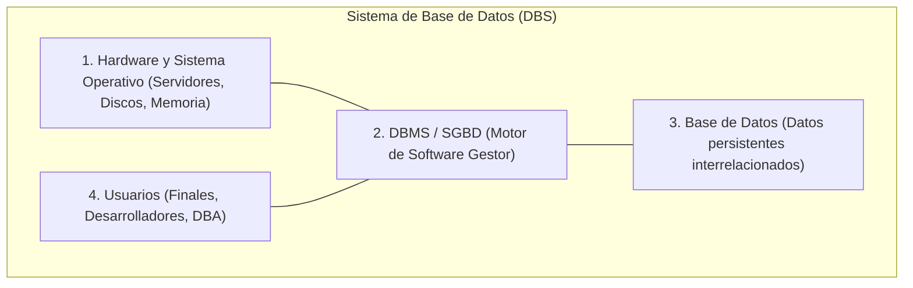
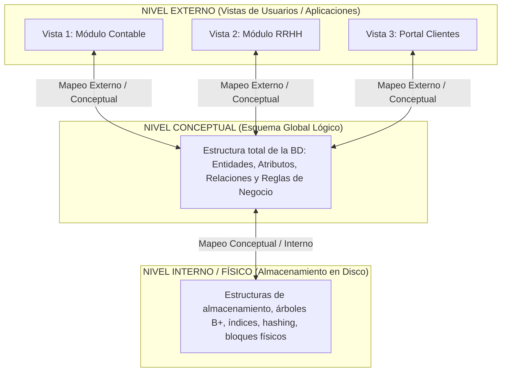
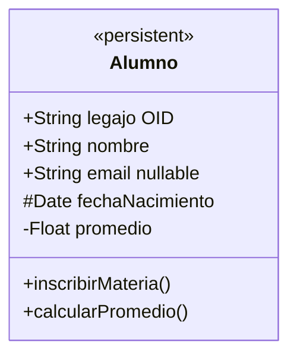
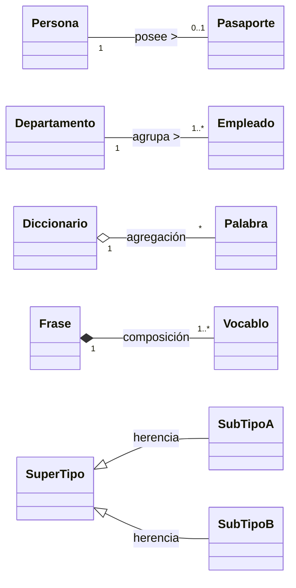
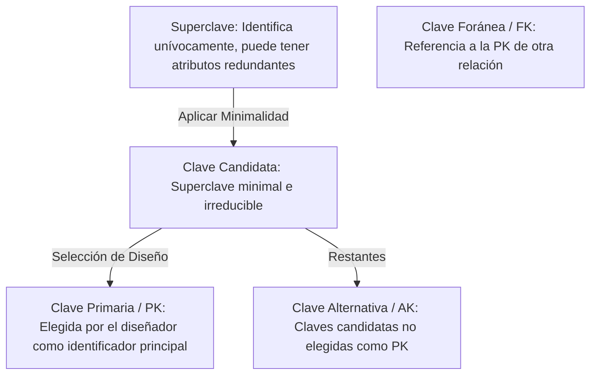
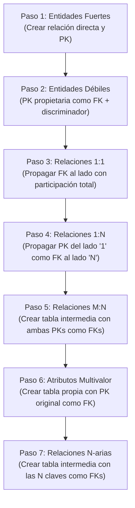
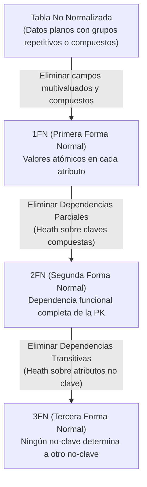
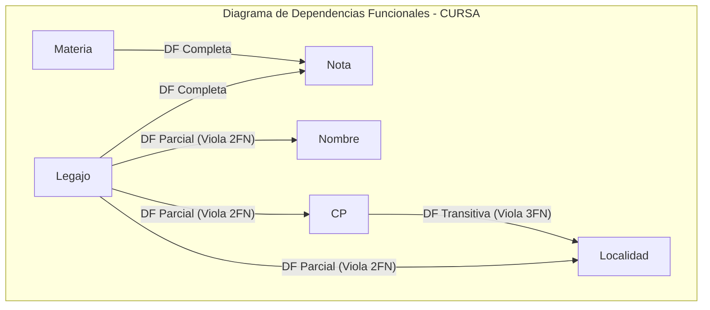

# Resumen Completo de Bases de Datos

## ==1. Introducción: Datos, Información y Sistemas==(amarillo)

### ==1.1. Conceptos Fundamentales==(celeste)

Para comprender el propósito de las bases de datos, es indispensable diferenciar los siguientes niveles conceptuales:

- **Dato:** Es el valor en crudo o representación simbólica de una propiedad, atributo o hecho aislado, sin procesar y sin contexto semántico inmediato (por ejemplo: `"Sánchez"`, `41`, `2026-08-17`).
- **Información:** Es un dato o conjunto de datos procesados, estructurados y contextualizados que adquieren un significado relevante y útil para un usuario en la toma de decisiones (por ejemplo: _"El cliente con apellido Sánchez tiene 41 años"_).
- ==**Sistema de Información (SI):**==(celeste) Es un conjunto formal y organizado de componentes (personas, datos, procesos y tecnología) diseñado para recolectar, almacenar, procesar, recuperar y distribuir información estratégica que apoye la gestión y toma de decisiones en una organización.


---

### ==1.2. Enfoque Tradicional de Ficheros vs. Enfoque de Bases de Datos==(celeste)

Históricamente, los sistemas dependían de archivos planos o ficheros gestionados directamente por el sistema operativo. Este paradigma presentó fallas estructurales graves que motivaron la creación de los Sistemas de Bases de Datos:

| Aspecto                    | Enfoque de Ficheros (Archivos Planos)                                                                                    | Enfoque de Bases de Datos (DBMS)                                                                                       |
| -------------------------- | ------------------------------------------------------------------------------------------------------------------------ | ---------------------------------------------------------------------------------------------------------------------- |
| **Redundancia**            | **Alta y descontrolada:** Los mismos datos se duplican en múltiples archivos de distintos programas.                     | **Controlada y mínima:** Datos integrados y centralizados en un único repositorio lógico.                              |
| **Consistencia**           | **Inconsistencias frecuentes:** Al actualizar un dato en un archivo, suele quedar desactualizado en otros.               | **Integridad garantizada:** Las modificaciones se propagan de forma única e inmediata.                                 |
| **Dependencia**            | **Dependencia física y lógica absoluta:** Si cambia el formato del archivo, se deben reprogramar todas las aplicaciones. | **Independencia de datos:** Las aplicaciones son inmunes a cambios en la estructura lógica o física de almacenamiento. |
| **Acceso a datos**         | **Rígido y complejo:** Cada nueva consulta requiere escribir un programa específico en código fuente.                    | **Flexible y declarativo:** Consultas ad-hoc inmediatas mediante lenguajes estándar de alto nivel (SQL).               |
| **Concurrencia**           | **Deficiente o nula:** Conflictos y sobreescrituras ante accesos simultáneos de varios usuarios.                         | **Control concurrente robusto:** Gestión de transacciones, bloqueos y aislamiento seguro.                              |
| **Seguridad e Integridad** | Difícil de coordinar; dispersa en el código de cada aplicación individual.                                               | Centralizada mediante políticas del motor (permisos, roles, restricciones de dominio y claves).                        |

---

<!-- PAGEBREAK -->

### ==1.3. El Sistema de Base de Datos (DBS) y sus Componentes==(celeste)

Un **Sistema de Base de Datos (DBS - Database System)** es un sistema informatizado global cuyo propósito es almacenar información persistente, facilitar su actualización y permitir un acceso eficiente y seguro.



#### ==Componentes Principales:==(rosa)

1. **Hardware y Sistema Operativo:** Infraestructura física (procesadores, memoria RAM, discos de almacenamiento) y software de base.
2. **DBMS / SGBD (Database Management System):** Conjunto de programas y utilidades complejas que gestionan de forma segura, eficiente e interactiva la creación, manipulación y administración de los datos.
3. **Base de Datos (BD):** Colección estructurada y persistente de datos interrelacionados, que comparten un significado inherente y representan un dominio de la realidad.
4. **Usuarios:** Actores que interactúan con el sistema:
   - **Usuarios Finales:** Operan con interfaces de usuario sin conocer la estructura subyacente.
   - **Programadores de Aplicaciones:** Desarrollan aplicaciones que interactúan con la BD mediante consultas y transacciones.
   - **Administrador de Base de Datos (DBA):** Máximo responsable técnico del control, diseño y rendimiento de la base de datos.

#### ==Funciones Clave del DBA (Database Administrator):==(rosa)

- Definir los esquemas conceptual e interno (diseño lógico y físico de la BD).
- Establecer y administrar las restricciones de seguridad, autenticación, autorización e integridad.
- Coordinar los requerimientos de la comunidad de usuarios y definir las vistas externas.
- Implementar y monitorear estrategias de respaldo (_backup_) y recuperación ante fallos (_recovery_).
- Optimizar el rendimiento del motor (ajuste de índices, particionado y balanceo de carga).

<!-- PAGEBREAK -->

## ==2. Arquitectura de Tres Niveles e Independencia de Datos==(amarillo)

### ==2.1. Arquitectura ANSI/SPARC==(celeste)

Para garantizar la abstracción de la información y ocultar la complejidad física a los usuarios finales, el estándar **ANSI/SPARC** establece una arquitectura dividida en tres niveles o esquemas:



1. **Nivel Interno (Esquema Físico):**
   - Nivel más bajo de abstracción.
   - Describe detalladamente **cómo se almacenan físicamente los datos** en los dispositivos de memoria secundaria (organización de registros, métodos de acceso, índices, estructuras de punteros y compresión).
2. **Nivel Conceptual (Esquema Lógico Global):**
   - Nivel intermedio que describe **qué datos se almacenan** para toda la comunidad de usuarios.
   - Modela la estructura completa: entidades, tipos de datos, relaciones, restricciones de integridad y reglas del negocio, prescindiendo por completo de detalles técnicos de hardware o software de almacenamiento.
3. **Nivel Externo (Vistas de Usuario):**
   - Nivel superior más cercano al usuario.
   - Consiste en múltiples esquemas externos (vistas parciales y personalizadas). Cada usuario o aplicación tiene acceso únicamente a la porción de datos relevante para su función, ocultando el resto de la base de datos por motivos de simplicidad y seguridad.

---

<!-- PAGEBREAK -->

### ==2.2. Independencia de Datos==(celeste)

La ==**independencia de datos**==(verde) es el objetivo primordial del enfoque de bases de datos. Se define como la **inmunidad de los programas de aplicación ante modificaciones en la estructura de los datos**.

- **Independencia Física de Datos:**
  - Capacidad de alterar el **esquema interno** (por ejemplo: migrar a discos SSD, reorganizar particiones, agregar o modificar un índice B+) sin necesidad de alterar el esquema conceptual ni los programas de aplicación.
  - _Mecanismo:_ Se logra mediante la flexibilidad del **mapeo entre el nivel conceptual y el nivel interno**.
- **Independencia Lógica de Datos:**
  - Capacidad de modificar el **esquema conceptual** (por ejemplo: agregar una nueva entidad, añadir atributos o cambiar relaciones) sin necesidad de reescribir ni recompilar las aplicaciones existentes que no utilicen dichos elementos.
  - _Mecanismo:_ Se logra mediante la asignación y **mapeo flexible entre el nivel conceptual y las vistas externas**.

---

### ==2.3. Lenguajes del DBMS==(celeste)

Los Sistemas de Gestión de Bases de Datos proporcionan sublenguajes especializados para interactuar con los esquemas:

- **DDL (Data Definition Language):** Permite declarar, crear, alterar y eliminar esquemas y objetos de la base de datos (tablas, índices, restricciones de integridad, vistas).
- **DML (Data Manipulation Language):** Permite consultar, insertar, actualizar y borrar tuplas o registros en la base de datos.
- **SQL (Structured Query Language):** Es el estándar universal de la industria que integra de forma declarativa tanto DDL como DML, control de transacciones y permisos de seguridad.

<!-- PAGEBREAK -->

## ==3. Modelado Conceptual de Datos: UML y Diagrama de Clases==(amarillo)

### ==3.1. Propósito del Diseño Conceptual==(celeste)

El diseño conceptual es la etapa inicial donde se modelan los requerimientos del mundo real en un alto nivel de abstracción. El diseñador se concentra exclusivamente en el **aspecto semántico y lógico**, desligándose de la implementación física que resolverá el DBMS.

#### ==Comparativa: Diagrama Entidad-Relación (E/R) vs. Diagrama de Clases UML==(rosa)

| Criterio             | Diagrama Entidad-Relación (E/R)               | Diagrama de Clases UML                                                        |
| -------------------- | --------------------------------------------- | ----------------------------------------------------------------------------- |
| **Alcance**          | Exclusivamente datos estructurales.           | Modela datos (atributos) y comportamiento (operaciones).                      |
| **Integración**      | Lenguaje específico para bases de datos.      | Unifica el lenguaje para analistas, arquitectos y programadores.              |
| **Herramientas**     | Herramientas exclusivas de modelado de datos. | Permite utilizar las mismas herramientas CASE en todo el ciclo de desarrollo. |
| **Relación Teórica** | Modelo tradicional clásico.                   | Es una generalización enriquecida del modelo E/R.                             |

---

<!-- PAGEBREAK -->

### ==3.2. Estructura de una Clase en UML==(celeste)

Una clase se representa visualmente como un rectángulo dividido en tres compartimentos horizontales:



1. **Nombre de la Clase:** Sustantivo singular (ej. `Alumno`, `Factura`). Si el nombre figura en _cursiva/itálica_, indica que es una **Clase Abstracta** (no se puede instanciar directamente).
2. **Atributos:** Características que describen a los objetos.
   - **Visibilidad:** `+` (público), `-` (privado), `#` (protegido), `~` (paquete).
   - **Tipo de dato:** `Integer`, `String`, `Date`, etc.
3. **Operaciones / Métodos:** Representan el comportamiento dinámico (en el diseño puramente estructural de bases de datos suelen omitirse o considerarse auxiliares).

#### ==Propiedades Extendidas (Estereotipos y Etiquetas)==(rosa)

- **Estereotipo `<<persistent>>`:** Señala que los objetos de esa clase deben persistir y almacenarse en la base de datos relacional.
- **Etiquetas de Propiedad `{ }`:**
  - `{OID}`: Por convención identifica el identificador de objeto o **Clave Primaria**.
  - `{alternate OID}`: Identifica una **Clave Alternativa** (restricción `UNIQUE`).
  - `{nullable}`: Especifica que el atributo permite valores nulos (opcional).

---

<!-- PAGEBREAK -->

### ==3.3. Relaciones y Multiplicidades (Cardinalidad)==(celeste)

Las relaciones añaden semántica vinculando clases entre sí:



- **Asociación Simple:** Conexión estructural estándar y bidireccional entre dos clases.
- **Agregación (Rombo hueco $\diamond$):** Relación "todo-parte" débil. Las partes tienen sentido y existencia independiente del todo (ej: un `Diccionario` y sus `Palabras`).
- **Composición (Rombo relleno $\blacklozenge$):** Relación "todo-parte" fuerte y de vida dependiente. La parte no tiene sentido ni existencia autónoma si se elimina el todo (ej: una `Frase` y sus `Vocablos`).
- **Generalización / Herencia (Triángulo $\triangle$):** Jerarquía entre un Supertipo y sus Subtipos.
  > [!NOTE]
  > En la transformación al modelo relacional, los subtipos que no agregan atributos propios carecen de relevancia semántica estructural.
- **Multiplicidad:** Rango de instancias permitidas: `0..1` (cero o uno), `1` (exactamente uno), `1..*` (uno o muchos), `0..*` o `*` (cero o muchos).

---

<!-- PAGEBREAK -->

### ==3.4. Casos Especiales de Diseño==(celeste)

- **Clase de Asociación:** Se utiliza cuando la relación entre dos clases posee atributos propios (por ejemplo: el atributo `nota` o `fechaExamen` que surge de la relación entre un `Alumno` y una `Materia`).
- **Promoción a Clase Completa:** Si una relación `M:N` con atributos propios necesita **almacenar un historial repetible** (por ejemplo: un alumno que recursa una materia varias veces sin que se sobreescriba su calificación anterior), la clase de asociación debe promoverse a una entidad independiente con ciclo de vida y clave propia.
- **Relaciones N-arias ($n > 2$):** Relaciones que involucran simultáneamente a tres o más clases (ejemplo: `Jugador`, `Equipo` y `Torneo`). Se representan gráficamente con un **rombo central**.

<!-- PAGEBREAK -->

## ==4. El Modelo Relacional==(amarillo)

Propuesto originalmente por ==**Edgar F. Codd en 1970**==(rosa) (IBM), revolucionó la gestión de datos basándose en la teoría matemática de relaciones y conjuntos de primer orden.

### ==4.1. Pilares y Ventajas del Modelo==(celeste)

El modelo relacional destaca por tres pilares fundamentales:

1. **Estructura de Datos:** Tablas bidimensionales homogéneas llamadas relaciones.
2. **Integridad de Datos:** Conjunto de restricciones que aseguran la exactitud y consistencia lógica.
3. **Manipulación de Datos:** Operaciones matemáticas sobre conjuntos para consultar y transformar registros.

> **Ventajas Principales:** Sencillez conceptual, uniformidad de representación, sólida base matemática e **independencia de la interfaz** (los lenguajes relacionales operan declarativamente sobre conjuntos completos de tuplas sin requerir conocimiento de la estructura física).

---

<!-- PAGEBREAK -->

### ==4.2. Terminología Estructural: Formal vs. Informal==(celeste)

| Concepto Formal                  | Concepto Informal / Práctico  | Definición Precisa                                                  |
| -------------------------------- | ----------------------------- | ------------------------------------------------------------------- |
| **Relación**                     | Tabla (instancia/cuerpo)      | Conjunto de tuplas que representan datos en un momento determinado. |
| **Variable Relacional (Relvar)** | Estructura / Esquema de Tabla | Encabezado o definición formal de los atributos y sus dominios.     |
| **Tupla**                        | Fila / Registro               | Elemento individual de una relación que agrupa valores asociados.   |
| **Atributo**                     | Columna / Campo               | Propiedad o característica nombrada de una relación.                |
| **Dominio**                      | Tipo de dato / Rango válido   | Conjunto de valores atómicos permitidos para un atributo.           |
| **Grado**                        | Cantidad de columnas          | Número total de atributos que componen el esquema.                  |
| **Cardinalidad**                 | Cantidad de filas             | Número total de tuplas contenidas actualmente en la relación.       |

---

<!-- PAGEBREAK -->

### ==4.3. Propiedades Formales de las Relaciones==(celeste)

Para que una tabla califique formalmente como una relación relacional, debe cumplir estrictamente con tres axiomas:

1. **Unicidad de Tuplas:** No pueden existir filas duplicadas en una relación (todo registro debe poseer al menos una clave que lo distinga).
2. **Desorden de Filas y Columnas:** El orden en que se visualizan o almacenan las tuplas y los atributos no tiene relevancia lógica alguna.
3. **Atomicidad de Atributos (Valor Atómico):** Cada celda de la relación debe contener un único valor indivisible; se prohíben valores compuestos, listas o conjuntos anidados.

---

### ==4.4. Tipos de Claves y Restricciones de Integridad==(celeste)

Una clave permite identificar de forma unívoca a cada tupla dentro de una relación. Debe satisfacer dos principios matemáticos:

- **Unicidad:** No pueden existir dos tuplas con el mismo valor en los atributos clave.
- **Minimalidad / Irreducibilidad:** No debe contener ningún atributo sobrante que pueda eliminarse manteniendo la unicidad.



- **Superclave:** Cualquier conjunto de uno o más atributos que identifique de forma unívoca a una tupla (puede tener atributos no indispensables).
- **Clave Candidata:** Toda superclave que cumple con la propiedad de **irreducibilidad** (conjunto minimal).
- **Clave Primaria (Primary Key - PK):** Es la clave candidata formalmente seleccionada por el diseñador para identificar unívocamente las tuplas en todo el sistema.
- **Clave Alternativa (Alternate Key / UNIQUE):** Son aquellas claves candidatas que no fueron designadas como primaria.
- **Clave Foránea o Relacional (Foreign Key - FK):** Atributo o conjunto de atributos en una relación cuyos valores deben coincidir con la clave primaria (PK) de otra relación (o de la misma relación en relaciones reflexivas).

#### ==Regla de Integridad Referencial==(rosa)

> [!IMPORTANT]
> ==**Regla de Integridad Referencial:**==(naranja) Los valores de una Clave Foránea (FK) deben coincidir exactamente con un valor existente de la Clave Primaria referenciada, o bien ser nulos (`NULL`) si la relación es opcional (`0..1`). No se permiten valores huérfanos o sin concordancia en la tabla destino.

<!-- PAGEBREAK -->

## ==5. Pasaje del Modelo Conceptual al Relacional (Mapeado)==(amarillo)

El diseño lógico consiste en transformar el Diagrama Conceptual (UML o E/R) en un conjunto de esquemas de relaciones relacionales mediante un algoritmo sistemático.

### ==5.1. Sintaxis Formal de Definición (Sublenguaje de Datos)==(celeste)

```sql
VAR BASE RELATION NombreRelacion (
    atributo1 Dominio1,
    atributo2 Dominio2,
    atributoN DominioN,
    PRIMARY KEY (atributo1),
    FOREIGN KEY (atributo2) REFERENCES OtraRelacion(claveDestino)
);
```

---

### ==5.2. Algoritmo de Mapeado ER-a-Relacional (7 Pasos Detallados)==(celeste)



1. **Paso 1 - Entidades Regulares (Fuertes):**
   - Se crea una relación para cada entidad con todos sus atributos simples.
   - Se selecciona su Clave Primaria `{OID}`.
2. **Paso 2 - Entidades Débiles:**
   - Se crea una relación que incluye todos los atributos simples de la entidad débil.
   - Se incluye como Clave Foránea (`FK`) la Clave Primaria de la entidad fuerte propietaria.
   - La Clave Primaria (`PK`) de la entidad débil es la combinación de la `FK` propietaria y su clave parcial (discriminador).
3. **Paso 3 - Relaciones Binarias 1:1:**
   - Se propaga la Clave Primaria de una de las entidades como `FK` en la otra.
   - _Criterio óptimo:_ Ubicar la `FK` en la entidad que tenga participación total (obligatoria, `1`) para evitar campos con valores nulos.
4. **Paso 4 - Relaciones Binarias 1:N:**
   - Se identifica la relación del lado **"N" (muchos)** y se incluye en ella la Clave Primaria de la entidad del lado **"1" (uno)** como Clave Foránea (`FK`).
5. **Paso 5 - Relaciones Binarias M:N:**
   - Se crea una **nueva tabla intermedia** (relación puente).
   - Contiene como Claves Foráneas (`FK`) las Claves Primarias de ambas entidades participantes.
   - La Clave Primaria (`PK`) de la nueva tabla es la combinación de ambas `FK`. Se agregan además los atributos propios de la relación.
6. **Paso 6 - Atributos Multivalor:**
   - Se crea una **nueva tabla** para almacenar el atributo repetitivo.
   - Se incluye la Clave Primaria de la entidad original como `FK`.
   - La `PK` de esta nueva tabla se forma por la combinación de la `FK` y el valor del atributo multivaluado.
7. **Paso 7 - Relaciones N-arias ($n > 2$):**
   - Se crea una **nueva tabla intermedia**.
   - Incluye como Claves Foráneas (`FK`) las claves primarias de todas las entidades participantes ($n$).
   - Generalmente, la `PK` de la tabla se conforma mediante la unión de todas esas `FK`.

<!-- PAGEBREAK -->

## ==6. Las 12 Reglas de Codd==(amarillo)

Formuladas por Edgar Codd, definen los requerimientos obligatorios que un motor de base de datos debe cumplir para considerarse **genuinamente relacional**:

- **Regla 0 (Fundacional):** Un DBMS relacional debe gestionar sus bases de datos exclusivamente mediante sus capacidades relacionales.
- **Regla 1 (De la Información):** Toda la información en la base de datos debe representarse explícitamente en el nivel lógico de una única forma: como valores en celdas de tablas.
- **Regla 2 (Acceso Garantizado):** Cada dato atómico individual debe ser lógicamente accesible mediante la combinación unívoca de: **Nombre de Tabla + Valor de Clave Primaria + Nombre de Columna**.
- **Regla 3 (Tratamiento Sistemático de Valores Nulos):** El DBMS debe soportar valores nulos (`NULL`), distintos de cero o cadenas de espacios vacíos, para representar información faltante o inaplicable de forma sistemática e independiente del tipo de dato.
- **Regla 4 (Catálogo Dinámico en Línea basado en el Modelo Relacional):** La descripción de la base de datos (metadatos / diccionario) se almacena y consulta exactamente de la misma manera que los datos comunes, utilizando el mismo lenguaje relacional.
- **Regla 5 (Sublenguaje de Datos Completo):** El sistema debe soportar al menos un lenguaje con sintaxis declarativa bien definida que cubra por completo: definición de datos (DDL), manipulación (DML), definición de vistas, restricciones de integridad, seguridad y límites de transacciones.
- **Regla 6 (Actualización de Vistas):** Cualquier vista que sea teóricamente actualizable por definición lógica debe poder ser actualizada por el sistema.
- **Regla 7 (Inserción, Modificación y Eliminación de Alto Nivel):** El sistema debe manejar conjuntos de registros (relaciones completas) como un único operando en consultas, inserciones, actualizaciones y borrados (no tupla a tupla obligatoriamente).
- **Regla 8 (Independencia Física de Datos):** Los cambios en la disposición de almacenamiento físico o métodos de acceso no deben afectar a las aplicaciones de usuario.
- **Regla 9 (Independencia Lógica de Datos):** Los cambios en las tablas base que preserven la información no deben requerir la modificación de los programas de aplicación existentes.
- **Regla 10 (Independencia de Integridad):** Las restricciones de integridad deben definirse mediante el sublenguaje relacional y almacenarse en el catálogo dinámico, nunca embebidas dentro de las aplicaciones cliente.
- **Regla 11 (Independencia de Distribución):** Las aplicaciones deben operar idénticamente tanto si los datos se encuentran en un único servidor centralizado como si están distribuidos geográficamente (transparencia de localización y fragmentación).
- **Regla 12 (No Subversión):** Si el sistema permite interfaces de bajo nivel (que procesan un registro a la vez), estas no pueden utilizarse para eludir o violar las reglas de integridad y seguridad definidas en el lenguaje relacional de alto nivel.

<!-- PAGEBREAK -->

## ==7. Calidad de Esquemas, Anomalías y Dependencias Funcionales==(amarillo)

### ==7.1. Criterios de Calidad y Anomalías de Diseño==(celeste)

La calidad de un esquema de base de datos se analiza en dos dimensiones:

- **Nivel Lógico:** Claridad semántica que facilita la interpretación correcta por parte de los desarrolladores y usuarios.
- **Nivel de Implementación:** Estructura física y lógica optimizada que evita redundancias e inconsistencias operativas.

Un mal diseño relacional (agrupar atributos heterogéneos en una sola tabla) genera **anomalías estructurales**:


- ==**Anomalía de Inserción:**==(rojo) Imposibilidad de almacenar un hecho legítimo porque faltan datos de otra entidad no vinculada directamente (ejemplo: _no poder dar de alta a un alumno en el sistema porque todavía no se ha matriculado en ninguna materia con nota_).
- ==**Anomalía de Modificación:**==(rojo) La redundancia de datos obliga a actualizar un mismo dato en múltiples filas. Si alguna fila se omite por error, el sistema entra en un estado inconsistente y contradictorio (ejemplo: _un alumno que cambia de teléfono y queda registrado con números diferentes en distintas materias cursadas_).
- ==**Anomalía de Eliminación:**==(rojo) Al borrar un registro para dar de baja un dato circunstancial, se pierde accidentalmente información vital irreemplazable (ejemplo: _al dar de baja la única materia que cursaba un alumno, se borran de la base de datos sus datos personales y su legajo_).

---

<!-- PAGEBREAK -->

### ==7.2. Dependencias Funcionales (DF)==(celeste)

La ==**Dependencia Funcional (DF)**==(rosa) es el concepto teórico fundamental para evaluar la calidad y estructuración de los esquemas relacionales.

> **Definición Formal:**  
> Dado un esquema de relación $R$ y dos subconjuntos de atributos $X, Y \subseteq R$, se dice que **$Y$ depende funcionalmente de $X$** (denotado $X \rightarrow Y$) si y solo si, para cualquier par de tuplas $t_1, t_2$ en cualquier estado válido de $R$, se cumple que:
> $$\text{Si } t_1[X] = t_2[X] \implies t_1[Y] = t_2[Y]$$

- **Determinante:** $X$ (lado izquierdo).
- **Dependiente:** $Y$ (lado derecho).
- **Permanencia:** Una DF es una restricción del mundo real y debe cumplirse en todo momento para cualquier instancia de datos válida.
- **Dependencia Trivial:** Ocurre cuando el dependiente es un subconjunto del determinante ($Y \subseteq X$). Por ejemplo: $\{ \text{DNI}, \text{Nombre} \} \rightarrow \text{Nombre}$.

---

### ==7.3. Axiomas de Armstrong y Reglas de Inferencia==(celeste)

Los ==**Axiomas de Armstrong**==(rosa) son un conjunto de reglas sólidas y completas que permiten deducir todas las dependencias funcionales lógicas a partir de un conjunto inicial de DFs ($F$).

#### ==Axiomas Básicos (Primitivos):==(rosa)

1. **Reflexividad:** Si $Y \subseteq X$, entonces $X \rightarrow Y$.
2. **Aumentación / Incremento:** Si $X \rightarrow Y$, entonces $XZ \rightarrow YZ$ (o $X \cup Z \rightarrow Y \cup Z$).
3. **Transitividad:** Si $X \rightarrow Y$ y $Y \rightarrow Z$, entonces $X \rightarrow Z$.

#### ==Reglas Derivadas (Deducibles de las Básicas):==(rosa)

- **Autodeterminación:** $X \rightarrow X$.
- **Descomposición / Proyección:** Si $X \rightarrow YZ$, entonces $X \rightarrow Y$ y $X \rightarrow Z$.
- **Unión / Aditiva:** Si $X \rightarrow Y$ y $X \rightarrow Z$, entonces $X \rightarrow YZ$.
- **Composición:** Si $X \rightarrow Y$ y $W \rightarrow Z$, entonces $XW \rightarrow YZ$.
- **Pseudotransitividad:** Si $X \rightarrow Y$ y $WY \rightarrow Z$, entonces $WX \rightarrow Z$.

---

<!-- PAGEBREAK -->

### ==7.4. Clausuras y Determinación de Claves==(celeste)

- **Clausura de un Conjunto de DFs ($F^+$ o $S^+$):** Es el conjunto de **todas** las dependencias funcionales que se pueden inferir lógicamente a partir del conjunto inicial $F$ aplicando los axiomas de Armstrong.
- **Clausura de un Conjunto de Atributos ($X^+$ o $A^+$):** Dado un conjunto de DFs $F$, la clausura $X^+$ es el conjunto de todos los atributos que dependen funcionalmente de $X$ bajo $F$.

#### ==Algoritmo para Identificar Superclaves y Claves Candidatas:==(rosa)

1. Se toma un subconjunto de atributos $K$.
2. Se calcula su clausura $K^+$.
3. Si $K^+$ contiene **todos los atributos del esquema $R$** ($K^+ = R$), entonces $K$ es una **Superclave**.
4. Si además ningún subconjunto propio de $K$ genera la totalidad de atributos ($K$ es irreducible), entonces $K$ es una **Clave Candidata**.

---

### ==7.5. Conjunto Irreducible de DFs (Cubrimiento Canónico / Minimal)==(celeste)

Un conjunto de dependencias funcionales $F$ es **irreducible** si cumple simultáneamente tres condiciones:

1. **Lado Derecho Atómico:** Todo dependiente (lado derecho) consta de un único atributo ($X \rightarrow A$).
2. **Lado Izquierdo Irreducible:** Ningún determinante (lado izquierdo) contiene atributos redundantes (no se puede quitar ningún atributo a la izquierda sin alterar la clausura $F^+$).
3. **No Redundancia Global:** No se puede eliminar ninguna DF del conjunto sin alterar la clausura total $F^+$.

> [!TIP]
> El conjunto irreducible es la base matemática requerida para ejecutar el proceso formal de normalización.

<!-- PAGEBREAK -->

## ==8. Normalización de Bases de Datos==(amarillo)

La **Normalización** es un proceso sistemático de descomposición de esquemas que optimiza la estructura lógica de las tablas para eliminar la redundancia y erradicar las anomalías de actualización.

### ==8.1. Propiedades de una Buena Descomposición==(celeste)

Para que la descomposición de un esquema $R$ en varios sub-esquemas $(R_1, R_2, \dots, R_k)$ sea válida, debe cumplir:

1. **Conservación / Preservación de la Información (Lossless Join):** Al reconstruir las tablas descompuestas mediante la operación de reunión natural (`JOIN`), se debe recuperar **exactamente la relación original**, sin pérdida de datos ni generación de tuplas espúreas o falsas.
2. **Conservación / Preservación de Dependencias Funcionales:** Todas las dependencias funcionales del esquema original deben poder validarse dentro de las relaciones descompuestas sin necesidad de realizar costosas operaciones de join entre tablas.
3. **Mínima Redundancia:** Los atributos deben almacenarse de forma no repetitiva, minimizando el espacio y el riesgo de inconsistencia.

---

### ==8.2. Descomposición sin Pérdida y Teorema de Heath==(celeste)

> ==**Teorema de Heath:**==(rosa)  
> Sea una relación $R(A, B, C)$ que satisface la dependencia funcional $A \rightarrow B$.  
> Entonces, $R$ se puede descomponer sin pérdida de información en sus dos proyecciones:
> $$R_1 = (A, B) \quad \text{y} \quad R_2 = (A, C)$$
> garantizando que:
> $$R = R_1 \bowtie R_2$$

---

<!-- PAGEBREAK -->

### ==8.3. Las Formas Normales (1FN, 2FN, 3FN)==(celeste)



#### ==1. Primera Forma Normal (1FN)==(rosa)

- **Regla:** Una relación está en 1FN si y solo si todos los atributos contienen exclusivamente ==**valores atómicos**==(verde) e indivisibles.
- **Qué se elimina:** Atributos multivaluados (ej: listas de teléfonos en una celda), atributos compuestos y grupos repetitivos.

#### ==2. Segunda Forma Normal (2FN)==(rosa)

- **Regla:** Una relación está en 2FN si está en 1FN y todos los atributos no clave tienen una ==**dependencia funcional completa e irreducible**==(verde) respecto a las claves candidatas.
- **Qué se elimina:** **Dependencias Parciales** (flechas de dependencia que parten desde un subconjunto de una clave primaria compuesta).
- _Condición de aplicación:_ Si la clave primaria es simple (un solo atributo), la relación en 1FN ya está automáticamente en 2FN.

<!-- PAGEBREAK -->

#### ==3. Tercera Forma Normal (3FN)==(rosa)

- **Regla:** Una relación está en 3FN si está en 2FN y ningún atributo no clave depende de forma ==**transitiva**==(verde) de ninguna clave candidata.
  - Formalmente: Para toda DF no trivial $X \rightarrow A$, se debe cumplir que **$X$ es superclave** o **$A$ es un atributo primo** (forma parte de una clave candidata).
- **Qué se elimina:** **Dependencias Transitivas** (atributos no clave que determinan a otros atributos no clave: $PK \rightarrow X \rightarrow Y$).

---

### ==8.4. Procedimiento Sistemático para Normalizar==(celeste)

1. **Identificar la Clave Primaria** y las claves candidatas de la relación original.
2. **Construir el Diagrama de Dependencias Funcionales** e identificar el conjunto irreducible.
3. **Verificar 1FN:** Asegurar atomicidad en todos los campos.
4. **Verificar 2FN:** Detectar dependencias parciales en claves compuestas y aplicar el **Teorema de Heath** para descomponer en tablas independientes.
5. **Verificar 3FN:** Detectar dependencias transitivas entre atributos no clave y aplicar el **Teorema de Heath** aislando la DF problemática.

<!-- PAGEBREAK -->

## ==9. Ejemplos Prácticos Completos de Normalización==(amarillo)

### ==9.1. Caso Práctico 1: Esquema Académico "CURSA"==(celeste)

Supongamos la relación universal inicial:

**CURSA** (<u>Legajo</u>, <u>Materia</u>, Nota, Nombre, CP, Localidad)

- **Clave Primaria Inicial:** `(Legajo, Materia)`
- **Dependencias Funcionales Reales:**
  1. $\{ \text{Legajo}, \text{Materia} \} \rightarrow \text{Nota}$ _(Dependencia funcional completa)_
  2. $\text{Legajo} \rightarrow \{ \text{Nombre}, \text{CP}, \text{Localidad} \}$ _(Dependencia parcial: Legajo es parte de la clave compuesta)_
  3. $\text{CP} \rightarrow \text{Localidad}$ _(Dependencia transitiva: CP no es superclave)_



#### ==Paso a 2FN:==(rosa)

- **Diagnóstico:** Existe la dependencia parcial $\text{Legajo} \rightarrow \{ \text{Nombre}, \text{CP}, \text{Localidad} \}$ que se origina en un subconjunto de la clave primaria compuesta `(Legajo, Materia)`. Viola 2FN.
- **Aplicación del Teorema de Heath:** Se divide la relación proyectando la clave completa con sus dependientes completos, y la clave parcial con sus respectivos atributos:
  - **Esquema A (2FN):** **INSCRIPCION** (<u>Legajo</u>, <u>Materia</u>, Nota)
  - **Esquema B (2FN):** **ALUMNO** (<u>Legajo</u>, Nombre, CP, Localidad)

#### ==Paso a 3FN:==(rosa)

- **Diagnóstico sobre Esquema B (ALUMNO):** En **ALUMNO**, la clave primaria es `Legajo`. Sin embargo, existe la dependencia transitiva $\text{CP} \rightarrow \text{Localidad}$ entre atributos no clave. Viola 3FN.
- **Aplicación del Teorema de Heath:** Se aísla la DF problemática separando `CP` y `Localidad` en una nueva relación:
  - **Esquema B1 (3FN):** **ALUMNO** (<u>Legajo</u>, Nombre, CP\*) _(donde `CP` es clave foránea hacia LOCALIDAD)_
  - **Esquema B2 (3FN):** **LOCALIDAD** (<u>CP</u>, Localidad)

#### ==Estructura Final Óptima en 3FN:==(rosa)

| Tabla           | Esquema Relacional (<u>PK</u>, _FK_)    | Descripción / Relaciones                                       |
| --------------- | --------------------------------------- | -------------------------------------------------------------- |
| **INSCRIPCION** | (<u>Legajo</u>\*, <u>Materia</u>, Nota) | PK: `(Legajo, Materia)` · FK: `Legajo` referencia a **ALUMNO** |
| **ALUMNO**      | (<u>Legajo</u>, Nombre, CP\*)           | PK: `Legajo` · FK: `CP` referencia a **LOCALIDAD**             |
| **LOCALIDAD**   | (<u>CP</u>, Localidad)                  | PK: `CP`                                                       |

---

<!-- PAGEBREAK -->

### ==9.2. Caso Práctico 2: Esquema Comercial "FACTURA"==(celeste)

Supongamos el registro de facturación general desnormalizado:

**FACTURA** (<u>nro_factura</u>, <u>sucursal</u>, fecha, forma_pago, cod_cliente, nombre_cliente, <u>cod_articulo</u>, nombre_articulo, precio_unitario, cantidad, subtotal, total)

- **Clave Primaria Compuesta:** `(nro_factura, sucursal, cod_articulo)`
- **Conjunto de Dependencias Funcionales:**
  1. $\{ \text{nro\_factura}, \text{sucursal} \} \rightarrow \{ \text{fecha}, \text{forma\_pago}, \text{cod\_cliente}, \text{total} \}$ _(Dependencia parcial respecto a la clave total)_
  2. $\text{cod\_cliente} \rightarrow \text{nombre\_cliente}$ _(Dependencia transitiva entre no claves)_
  3. $\text{cod\_articulo} \rightarrow \{ \text{nombre\_articulo}, \text{precio\_unitario} \}$ _(Dependencia parcial respecto a la clave total)_
  4. $\{ \text{nro\_factura}, \text{sucursal}, \text{cod\_articulo} \} \rightarrow \{ \text{cantidad}, \text{subtotal} \}$ _(Dependencia completa de la clave total)_

#### ==Resolución y Descomposición Sistemática a 3FN:==(rosa)

1. **Tabla Renglón de Factura (Detalle):**
   - **DETALLE_FACTURA** (<u>nro_factura</u>\*, <u>sucursal</u>\*, <u>cod_articulo</u>\*, cantidad, subtotal)
   - _Clave Primaria:_ `(nro_factura, sucursal, cod_articulo)`
   - _Claves Foráneas:_ `(nro_factura, sucursal)` referencia a **CABECERA_FACTURA**; `cod_articulo` referencia a **ARTICULO**.
   - _Justificación:_ Modela la dependencia completa de la clave compuesta.

2. **Tabla Cabecera de Factura:**
   - **CABECERA_FACTURA** (<u>nro_factura</u>, <u>sucursal</u>, fecha, forma_pago, cod_cliente\*, total)
   - _Clave Primaria:_ `(nro_factura, sucursal)`
   - _Clave Foránea:_ `cod_cliente` referencia a **CLIENTE**.
   - _Justificación:_ Aísla los datos del comprobante que dependían únicamente de `(nro_factura, sucursal)` (elimina dependencia parcial).

3. **Tabla Cliente:**
   - **CLIENTE** (<u>cod_cliente</u>, nombre_cliente)
   - _Clave Primaria:_ `cod_cliente`
   - _Justificación:_ Aísla los datos del cliente (elimina dependencia transitiva).

4. **Tabla Artículo:**
   - **ARTICULO** (<u>cod_articulo</u>, nombre_articulo, precio_unitario)
   - _Clave Primaria:_ `cod_articulo`
   - _Justificación:_ Aísla los datos del artículo que dependían solo de `cod_articulo` (elimina dependencia parcial).

#### ==Estructura Final Óptima en 3FN:==(rosa)

| Tabla                | Esquema Relacional (<u>PK</u>, _FK_)                                                 | Claves y Referencias                                                                                  |
| -------------------- | ------------------------------------------------------------------------------------ | ----------------------------------------------------------------------------------------------------- |
| **DETALLE_FACTURA**  | (<u>nro_factura</u>\*, <u>sucursal</u>\*, <u>cod_articulo</u>\*, cantidad, subtotal) | **PK:** `(nro_factura, sucursal, cod_articulo)`<br>**FKs:** `(nro_factura, sucursal)`, `cod_articulo` |
| **CABECERA_FACTURA** | (<u>nro_factura</u>, <u>sucursal</u>, fecha, forma_pago, cod_cliente\*, total)       | **PK:** `(nro_factura, sucursal)`<br>**FK:** `cod_cliente`                                            |
| **CLIENTE**          | (<u>cod_cliente</u>, nombre_cliente)                                                 | **PK:** `cod_cliente`                                                                                 |
| **ARTICULO**         | (<u>cod_articulo</u>, nombre_articulo, precio_unitario)                              | **PK:** `cod_articulo`                                                                                |

> **Conclusión del Diseño:** El esquema resultante cumple ==**1FN**==(verde) (atributos atómicos), ==**2FN**==(verde) (sin dependencias parciales) y ==**3FN**==(verde) (sin dependencias transitivas), garantizando **cero redundancia**, **conservación de dependencias** y **descomposición sin pérdida de información (_Lossless Join_)**.
