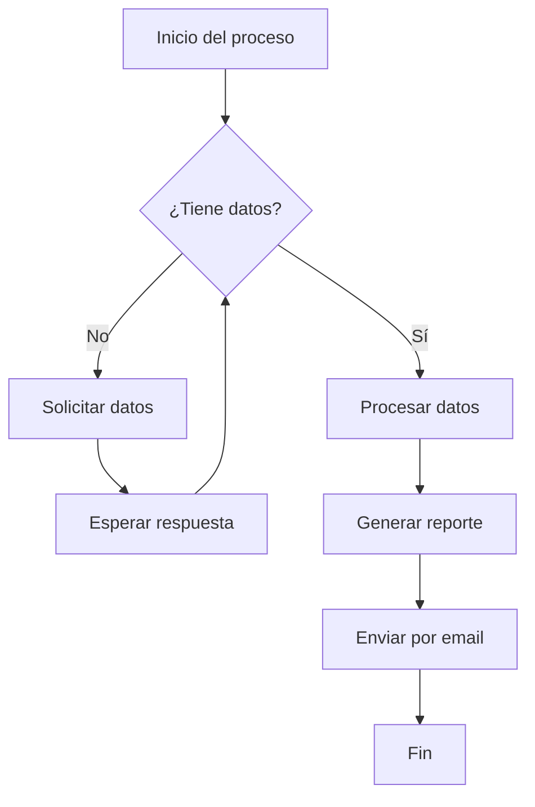

---
coverConfig:
  showCover: true
  title: Trabajo Integrador Final
  subtitle: Análisis de Sistemas
  materia: Taller de Integración
  coverStyle: academic_elegant
  showLogo: true
  integrantes:
    - ''
  profesores:
    - ''
  sigla: TI
  fecha: 15/09/2026
  showHeader: true
  showFooter: true
activeTheme: minimal
---
# Documento de Prueba — PDF Converter

Este documento muestra **todas las funcionalidades** disponibles en la app. Podés usarlo como referencia al escribir tus propios documentos.

---

## 1. Tipografía básica

Esto es un párrafo normal. Podés escribir texto con **negrita**, *cursiva*, ~~tachado~~ y `código inline`.

También podés combinarlos: **_negrita y cursiva_**, `**no funciona dentro de código**`.

Esto es un [enlace de ejemplo](https://example.com).

---

## 2. Encabezados

# H1 — Título principal
## H2 — Sección
### H3 — Subsección

---

## 3. Listas

**Lista sin orden:**

- Elemento uno
- Elemento dos
  - Sub-elemento A
  - Sub-elemento B
- Elemento tres

**Lista con orden:**

1. Primer paso
2. Segundo paso
   1. Sub-paso 2.1
   2. Sub-paso 2.2
3. Tercer paso

---

## 4. Cita en bloque

> "La simplicidad es la máxima sofisticación."
>
> — Leonardo da Vinci

---

## 5. Código

**Bloque de código (JavaScript):**

```javascript
function fibonacci(n) {
  if (n <= 1) return n;
  return fibonacci(n - 1) + fibonacci(n - 2);
}

console.log(fibonacci(10)); // 55
```

**Bloque de código (Python):**

```python
def calcular_promedio(numeros):
    return sum(numeros) / len(numeros)

datos = [8, 7, 9, 6, 10]
print(f"Promedio: {calcular_promedio(datos):.2f}")
```

---

## 6. Tabla

| Nombre       | Materia        | Nota | Estado   |
| :----------- | :------------- | ---: | :------: |
| Ana García   | Matemáticas    |  9.5 | Aprobado |
| Carlos López | Física         |  7.0 | Aprobado |
| Sofía Martín | Química        |  4.5 | Pendiente|
| Juan Rodríguez | Programación |  10  | Aprobado |

---

## 7. Ecuaciones matemáticas

Ecuación inline: $E = mc^2$

Ecuación en bloque:

$$
\int_{-\infty}^{\infty} e^{-x^2} dx = \sqrt{\pi}
$$

Sistema de ecuaciones:

$$
\begin{cases}
  2x + 3y = 12 \\
  x - y = 1
\end{cases}
$$

---

## 8. Diagrama Mermaid



---

## 9. Salto de página

El texto de arriba está en la página 1. El contenido debajo del marcador empieza en una nueva página al exportar a PDF.

\newpage

## 10. Segunda página (después del salto)

Este contenido aparece en la segunda página del PDF exportado.

Podés usar saltos de página para separar secciones importantes como:

- Portada
- Índice
- Capítulos
- Anexos

---

## 11. Imagen pegada

> **Tip:** Podés pegar imágenes directamente en el editor con Ctrl+V.  
> Se guardan automáticamente en `public/uploads/` y se insertan como Markdown.

---

*Fin del documento de prueba. Exportá a PDF para ver el resultado final.*
