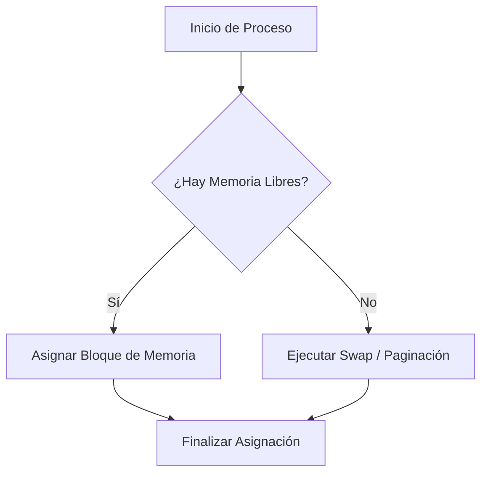

# Informe Técnico: Arquitectura y Gestión de Memoria

==Este es un documento de demostración==(celeste) creado para probar las características de **PDF Converter (v2)**.

---

## 1. Introducción al Resaltado Pastel

Podés aplicar resaltados de texto en diferentes tonos pastel para destacar conceptos clave:

* Concepto por defecto: ==texto resaltado estándar==(amarillo)
* Concepto en rosa: ==definición importante==(rosa)
* Concepto en rojo: ==advertencia o error crítico==(rojo)
* Concepto en verde: ==solución o estado exitoso==(verde)
* Concepto en celeste: ==referencia técnica==(celeste)
* Concepto en naranja: ==nota aclaratoria==(naranja)
* Concepto en violeta: ==conclusión o resumen==(violeta)

También se pueden combinar formatos internos, como ==**resaltado en negrita**==(rosa) o ==*resaltado en cursiva*==(verde).

<!-- PAGEBREAK -->

## 2. Paginación Física A4 y Control Manual

El documento fluye de manera natural a través de las hojas A4. Cuando querés forzar el inicio de un nuevo apartado en una hoja limpia, colocás el marcador:

```markdown
<!-- PAGEBREAK -->
```

### 2.1. Tabla Comparativa de Temas

| Tema | Estilo Visual | Uso Recomendado |
|---|---|---|
| **Minimalista Moderno** | Limpio y plano con tipografía sans-serif | Informes generales y notas rápidas |
| **Académico Clásico** | Estilo tradicional en tonos crema con serif | Ensayos, tesis y trabajos prácticos |
| **Institucional** | Profesional con encabezados en azul corporativo | Informes empresariales e institucionales |
| **Editorial Moderno** | Títulos serif en tono borgoña/vino | Revistas, artículos y publicaciones |
| **Técnico Claro** | Estilo técnico limpio con acentos en azul eléctrico | Documentación de sistemas y software |
| **Cuadernillo Pastel** | Fondo suave crema con bordes redondeados | Apuntes de estudio y resúmenes |

<!-- PAGEBREAK -->

## 3. Demostración de Código y Matemáticas

### 3.1. Algoritmo de Gestión de Memoria (Python)

```python
def asignar_memoria(proceso_id: str, tamano_mb: int, bloques_libres: list) -> int:
    """
    Ejemplo de código formateado con resaltado sintáctico.
    """
    for i, bloque in enumerate(bloques_libres):
        if bloque['tamano'] >= tamano_mb:
            print(f"Asignando {proceso_id} en bloque {i}")
            bloque['tamano'] -= tamano_mb
            return bloque['dir_inicio']
    return -1  # Memoria insuficiente
```

### 3.2. Fórmulas Matemáticas (KaTeX)

Podés escribir ecuaciones matemáticas inline como $E = mc^2$ o ecuaciones centradas en bloque:

$$\text{Rendimiento} = \frac{\text{Tiempo Efectivo}}{\text{Tiempo Total}} \times 100\%$$

$$\sum_{i=1}^{n} i = \frac{n(n+1)}{2}$$

<!-- PAGEBREAK -->

### 3.3. Diagramas Mermaid (Flowchart)



---

> **Nota:** Podés hacer clic en **📖 Configurar Portada** en la barra superior para agregar el título general, materia, integrantes y profesores a la carátula de este documento.
